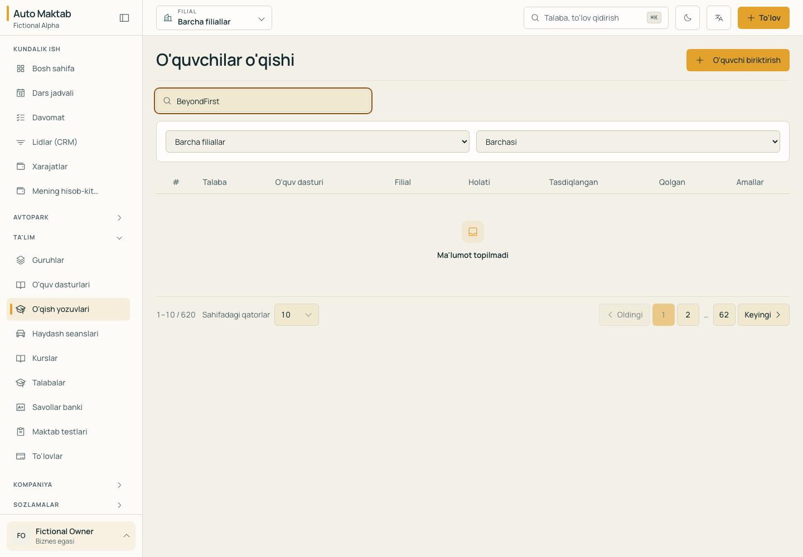
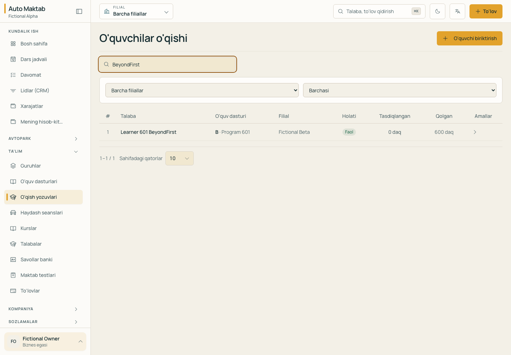
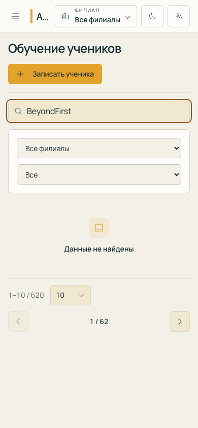
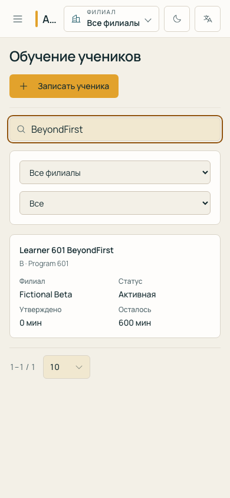
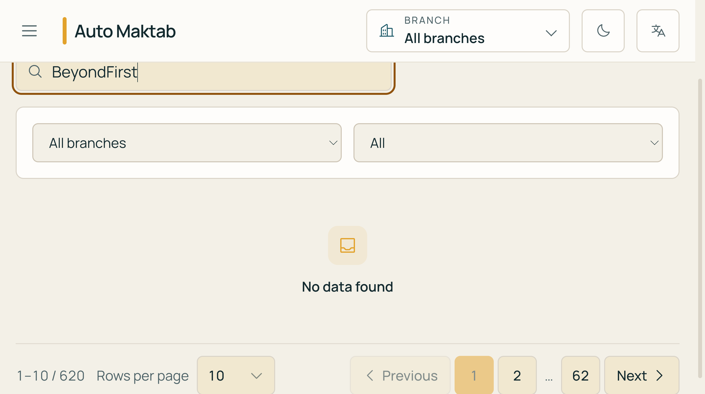
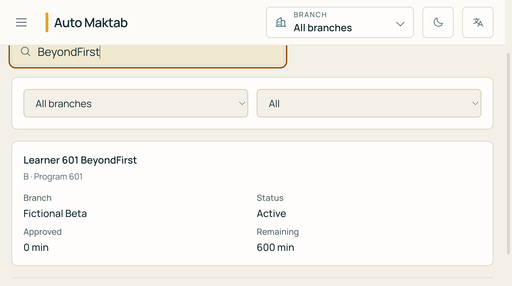

# Issue #315: enrollment list search

Search now filters snapshot names, category and program name before server pagination/counting. The frontend sends normalized debounced search and its abort signal, resets pagination and uses authoritative rows. Existing company/branch/student/status/deletion/grant scope remains intact. The enrollment picker and program lookup are unchanged.

The optional `search_legacy` boolean is true only when the current translated legacy label matches a nonempty query; the server includes null-program records inside the existing scope. Empty search retains ordinary list semantics. Frontend and backend must be delivered together. This is only the enrollment-list part of #315.

Independent FE full suite: 1,403 tests, 224 files passed with unchanged default timeout. Initial concurrent timeout failures remain in local evidence. BE focused 42 tests and static/build/ownership gates passed; local full run retained 1,034 passes and two sandbox HTTP failures, followed by 12 passing tests from the exact two unchanged HTTP files. This is not one green local backend full run; exact commit CI is required.

The real generated route used 620 fictional enrollments and intercepted APIs. Checks covered matches beyond 50/500, literal wildcard text, zero/clear, delayed queries/cancellation, history/reload/page reset, branch/status/access scopes, localized legacy matching, error/retry, keyboard and both themes. Browser fixtures and service mocks do not establish live DB/RLS, actual deployment, physical-device, screen-reader or full WCAG acceptance. No production mutations occurred.

## Raw before/after screenshots

Unedited browser captures show the late enrollment absent before and present after. Desktop UZ and mobile RU use identical viewports. Native EN uses real Chrome 200% preferences: inner 720×403, outer 1440×893, DPR 4, visual scale 1 and root/body CSS zoom 1. Requested scroll 100 produced 100 versus 100.5 CSS pixels; this fractional offset is disclosed. A strict exact-scroll harness assertion failed and remains preserved; a separate postcapture assessment accepted the 0.5-pixel difference with identical geometry and verified result/network state. Earlier unmatched-window attempts are excluded from this gallery.

### UZ — desktop

Before: 

After: 

### RU — 390

Before: 

After: 

### EN — native200

Before: 

After: 
