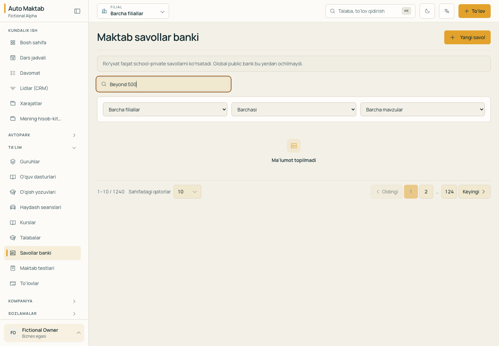
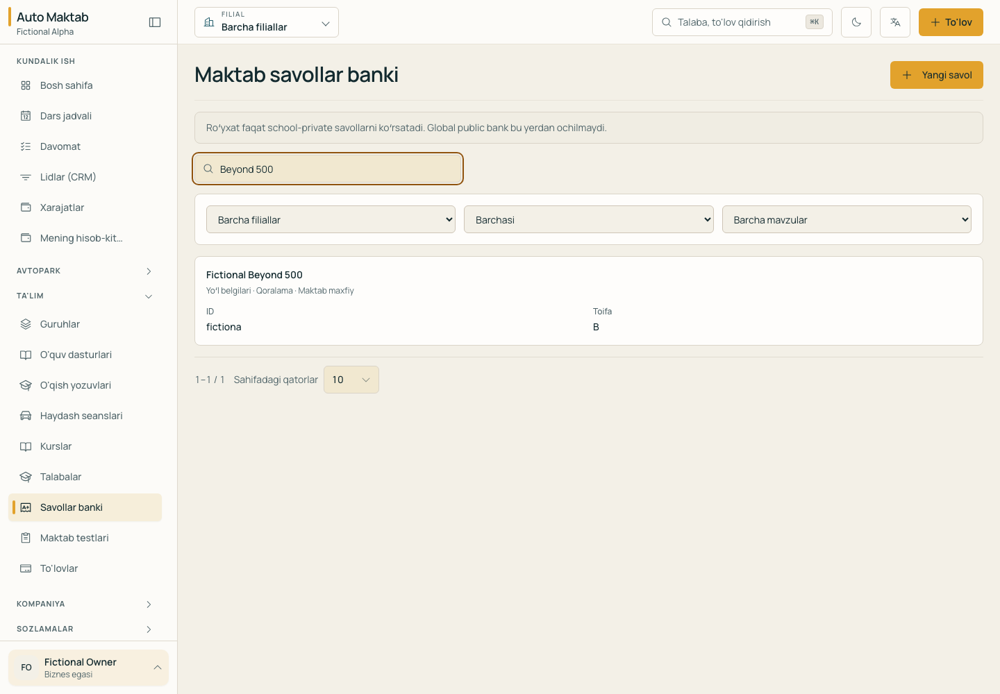
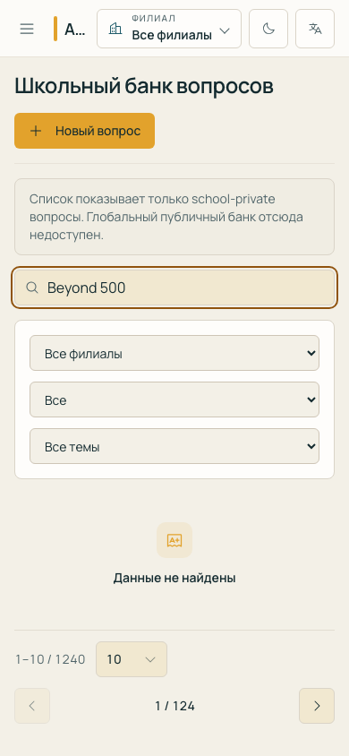
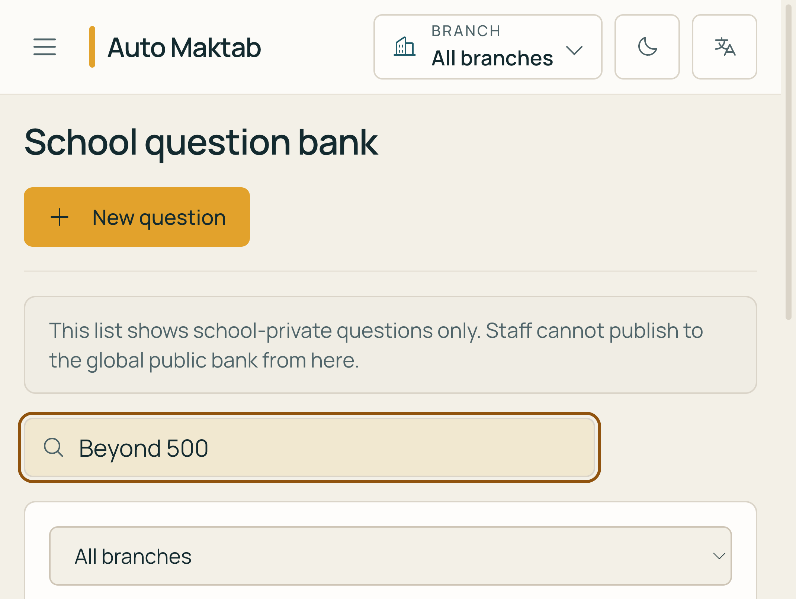

# Issue #315: questions search

Search now applies on the server before pagination and total counting. The frontend sends the normalized query and abort signal, resets pagination, and renders the returned cohort. Existing visibility, branch, status, topic and ownership constraints remain in the backend query. Optional search is trimmed and bounded to 200 characters; wildcard characters remain literal.

This addresses only the questions route of #315. Frontend and backend changes must be delivered together. No production or database writes were performed.

Independent QA: FE 1,402 tests plus types, zero-warning lint, changed-file formatting, build and bundle checks passed. BE focused 42 tests and static/build/ownership checks passed. Its full local run retained two sandbox socket failures alongside 1,023 passing tests; a separately authorized unchanged HTTP subset passed 12 tests. Exact commit CI is required.

The actual generated route used intercepted synthetic APIs with 1,240 questions and a 620-question limited branch cohort. Checks covered matches beyond 50/500, delayed queries, cancellation, empty/error/retry, pagination, browser history, scope, keyboard and both themes. These checks do not establish live database/RLS, physical-device, screen-reader or full WCAG acceptance.

## Raw before/after screenshots

The baseline misses the late match; the candidate returns it with total 1. Images are unedited browser captures. Native 200% used owned Chrome profile preferences; measured viewport 535×403, DPR 4, visual viewport scale 1 and root/body CSS zoom 1.

### UZ — 1440x1000

Before: 

After: 

### RU — 390x844

Before: 

After: 

### EN — native200 measured535x403

Before: 

After: 
