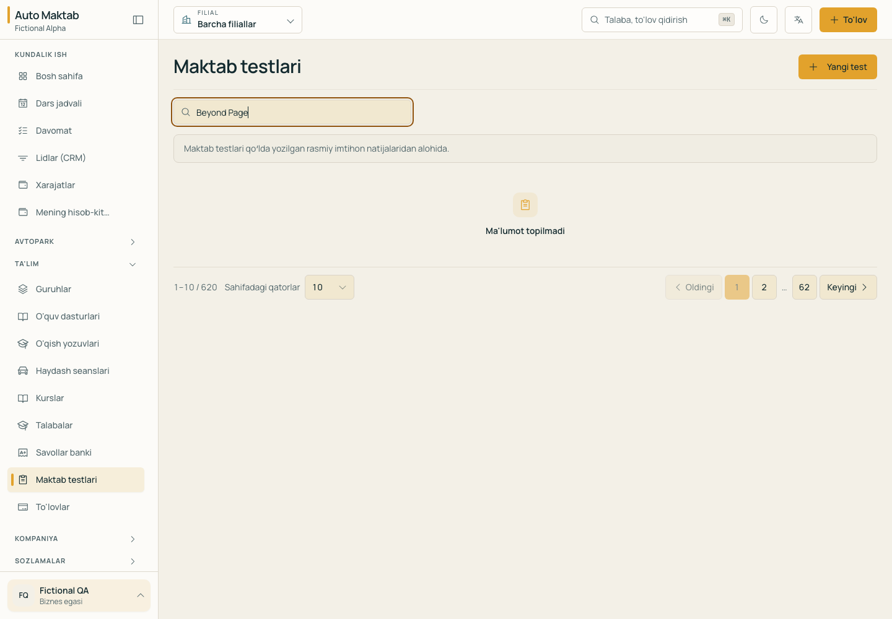
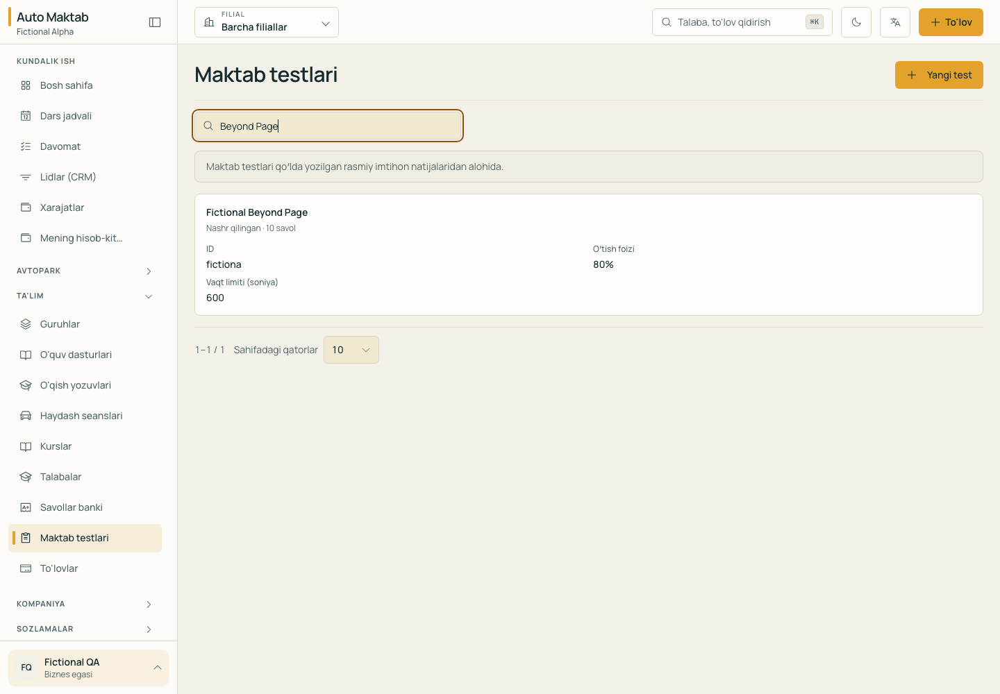
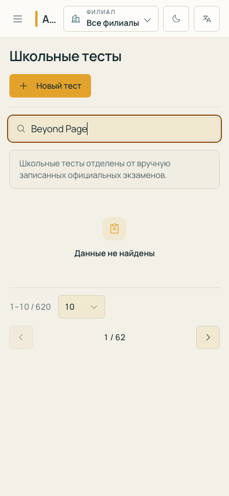
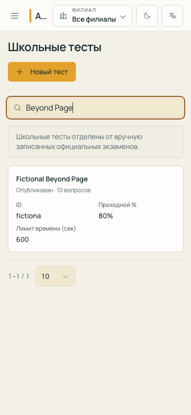
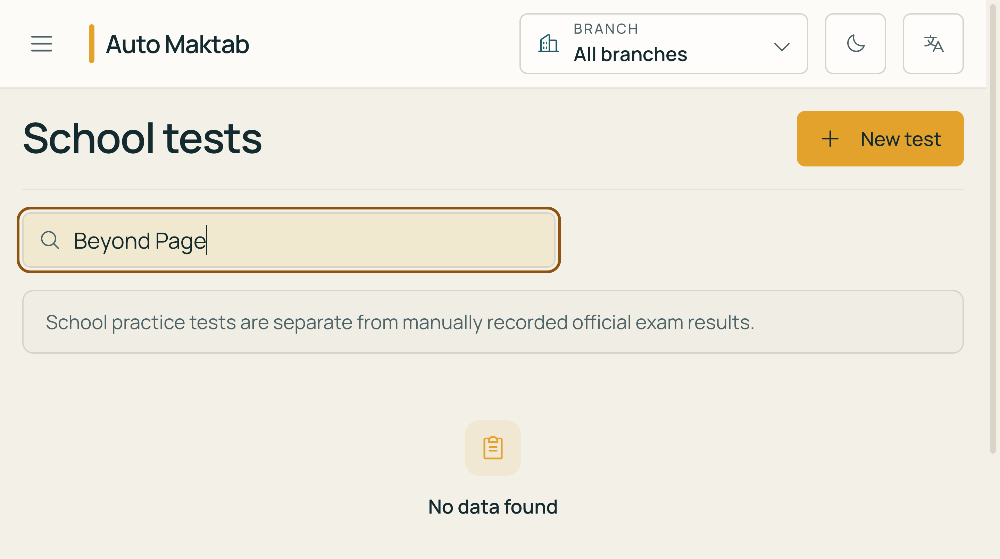
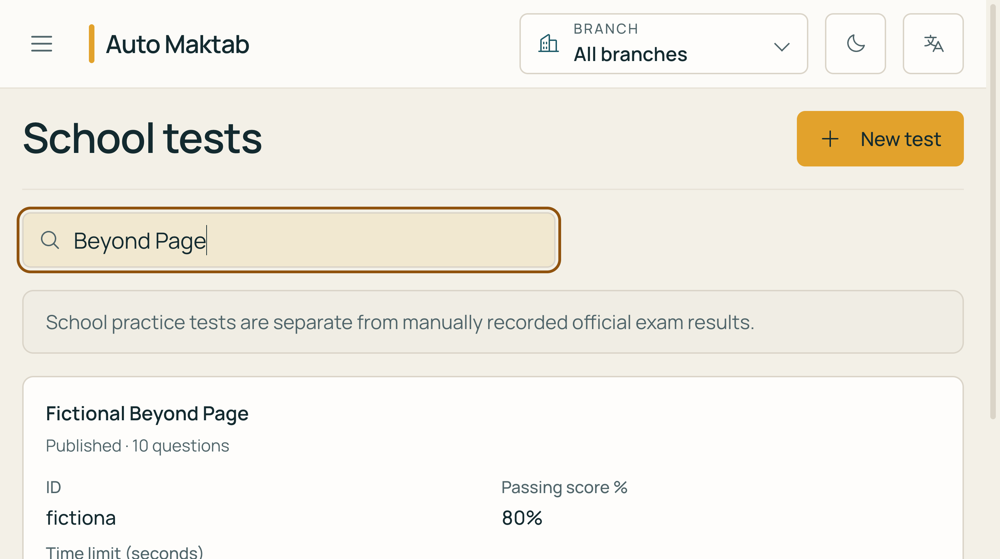

# Issue #315: school-test search before pagination

School-test templates now match title, description and category before server pagination and counting. Existing company, branch, ownership, deletion, visibility and permission filters remain authoritative. Optional search is trimmed and bounded; literal wildcard text is escaped; rows and count share the same filter and stable ordering. Frontend query identity includes the current search/access scope, with abort propagation, debounce feedback, page reset/history, empty and error/retry states.

Independent capture snapshot `d5be26159d76811a1e39bf48a02b5d9d70c82336238f83c06cbb3ba014b201d9`: FE base `eb011c881603371a831e102709c000db852a56eb`, BE base `7a6d9dfdc4a5ce864222153af656933ee4d2ad37`. FE full 1,410 tests/227 files passed at the unchanged default timeout; focused/static/build checks passed. The BE local full run retained 1,040 passing tests and two sandbox HTTP-bind failures; those 12 unchanged HTTP tests passed separately. This is not a single green local BE full run.

Actual generated-route synthetic fixtures cover more than 500 records, late matches, literal/description/zero/clear queries, page reset/history/reload, delayed/error/retry, limited access, keyboard and both themes. Cached query restoration correctly need not issue a new GET; initial overly strict harness assertions and native scroll calibration failures remain preserved locally.

## Raw before/after comparisons

These six PNGs are unedited actual browser captures from the old snapshot above. Native Chrome200% pairs have equal outer1440×893/inner720×403, DPR4, visual scale1, CSSzoom1 and actual scroll0. Mobile390 is browser emulation. New main integration retains all eight source hashes and the school-test rendering boundary; fresh integration checks and exact-commit CI remain separate gates. No physical-device, actual screen-reader, full WCAG, deployed or real DB/RLS acceptance is implied. All browser API fixtures were intercepted locally; no production writes occurred.

### UZ desktop

Before: 

After: 

### RU390

Before: 

After: 

### EN native200

Before: 

After: 
