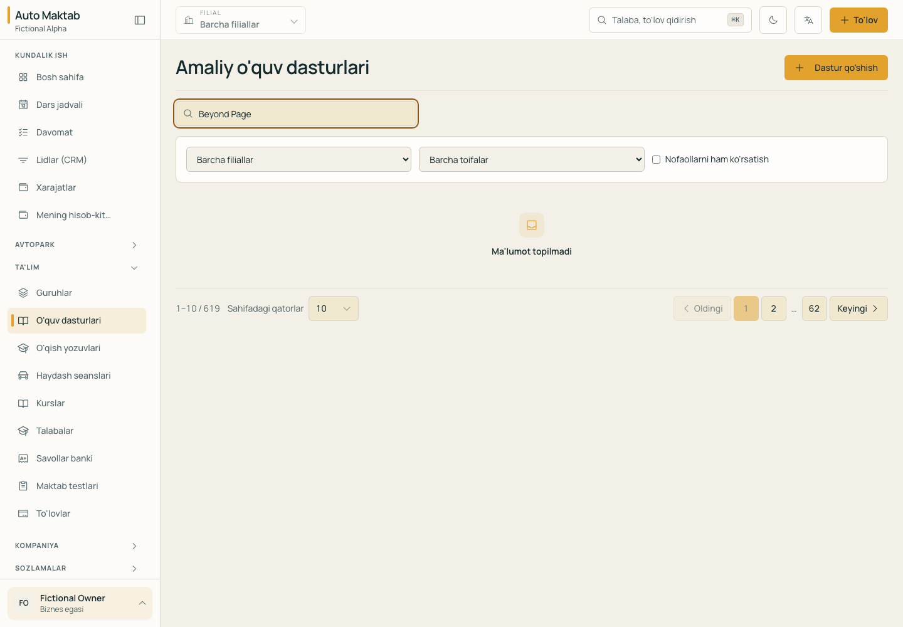
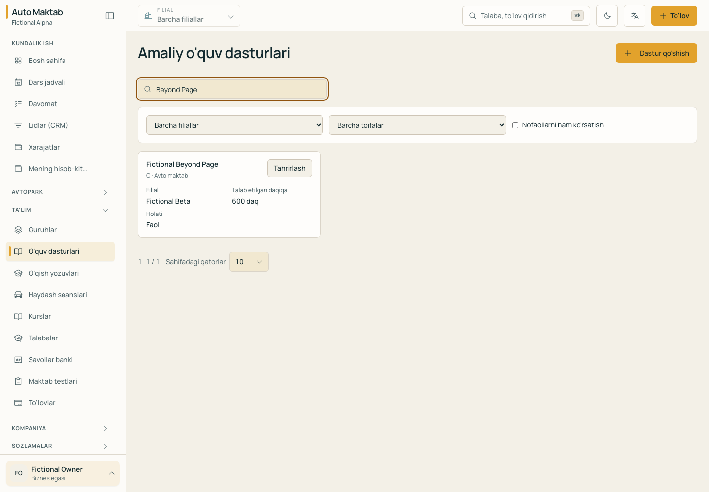
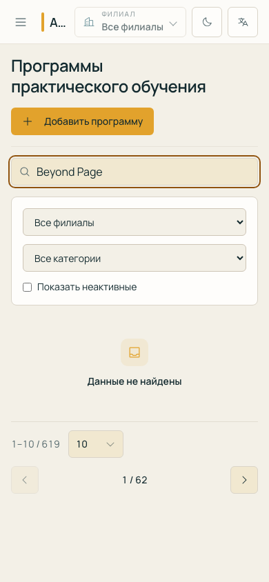
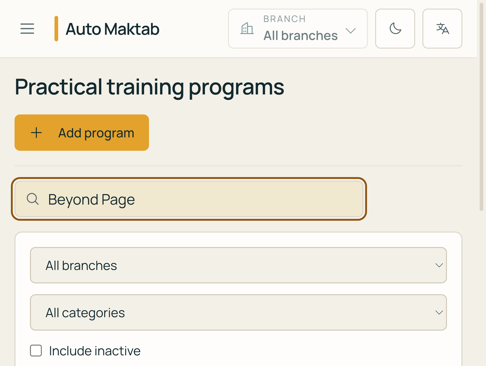

# Issue #315: search before training-program pagination

Before frontend: `8e70fd5d4d2c2e652b13e3c874d52f6f50db7d0b`. After paired source candidate: `84ae8f1af7ac909148a6f4dd7a73839fc7b9f0931dbd5aa44e6eb2e8024cdced`; backend base `95adc976e55aa9fe396c0f4d672e716188b758e4`.

Search previously filtered only the loaded page. The frontend now sends the debounced query and renders the server-filtered page/count. The paired backend searches literal name/category and raw course-type values before pagination/count, retaining company/branch/category/active scope and deterministic createdAt/id ordering. Literal percent, underscore and backslash are escaped for text matching; the enum comparison uses the raw search term.

Actual generated-route screenshots use 620 fictional programs (619 active), intercepted GET fixtures, Chromium153.0.8010.12 and unedited viewport PNGs. Browser fixture observations are separate from actual PostgreSQL/RLS acceptance. No production writes or data were used.

| Scenario | Before | After |
| --- | --- | --- |
| Uzbek desktop: a matching program beyond the loaded page |  |  |
| Russian mobile emulation, 390px |  |  |
| English native browser 200% zoom |  |  |

Independent QA: frontend1,388 tests/223 files and eight focused tests passed; backend21 focused tests, both typechecks/lints/formatting, frontend production synthetic build/bundle, backend equivalent Nest/alias build and ownership checks passed. Original backend full unit run:1,004 tests passed and two sandbox-listener failures; those unchanged mocked HTTP files separately reran12/12 passing. This is not a single full-suite local PASS.

The unchanged new tenant-RLS search assertion passed on a verified NEW disposable PostgreSQL16.14 database at the normal5s timeout/default transactions. Runtime constrained-role flags and actual application sessions were observed. It covers counts/order/literal/enum/tenant/branch behavior. The other28 assertions were filtered; full permissions/money/e2e suites were NOT RUN locally. No existing database, migration/seed/reset target or production record was touched. Only existing migrations and finite fixtures ran on the verified temporary database, which was removed.

Light UZ/RU/EN and dark desktop/mobile loading/error/retry/empty/keyboard/scope tests passed, including obsolete-request abort, debounce, repeated cached query recovery, history and filtered page reset. Native zoom used an owned browser profile, not CSS zoom. Source/config/installed package content stayed unchanged; the Vitest result cache alone changed. Cached React Doctor0.9.14 diagnostics exited0 with no errors; structural warnings were individually triaged, without an online score or unrelated refactor.

This is only the first training-program route slice of #315. The issue's other three routes remain outside this change. Exact feature-commit CI remains a publication gate; no whole-issue or production-integration acceptance is claimed.
