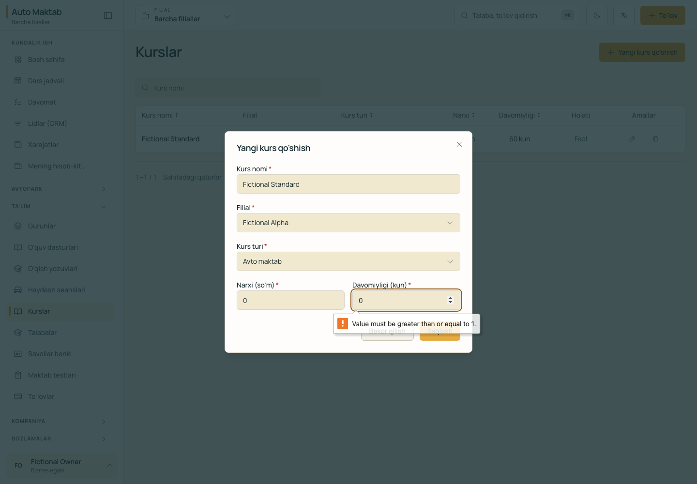
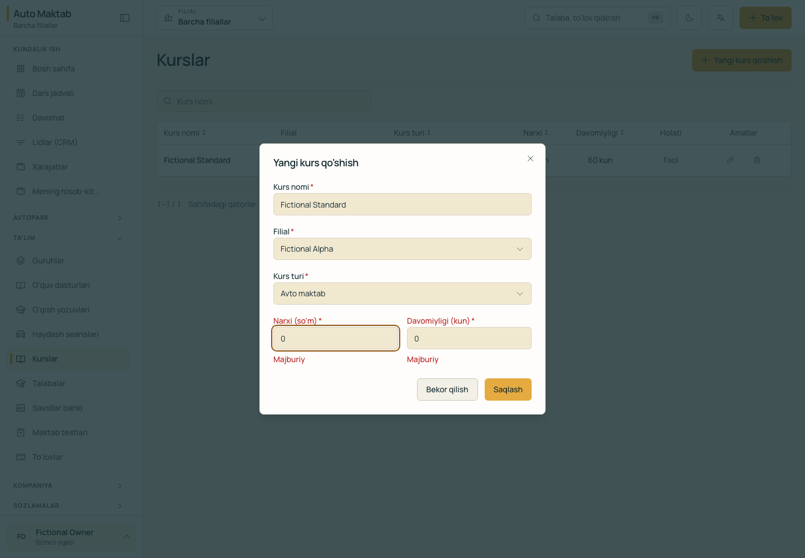
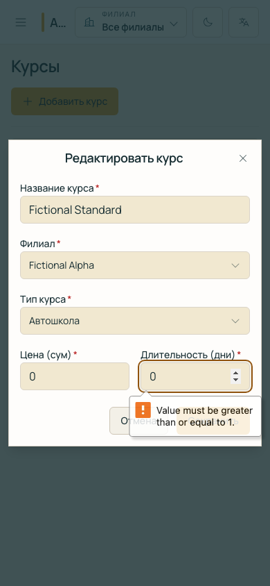
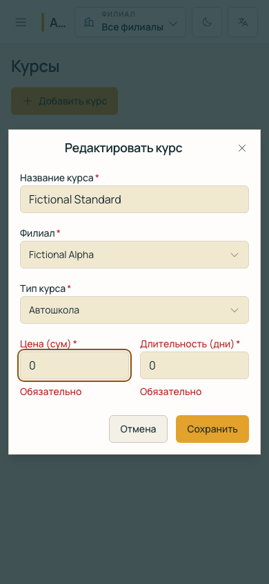
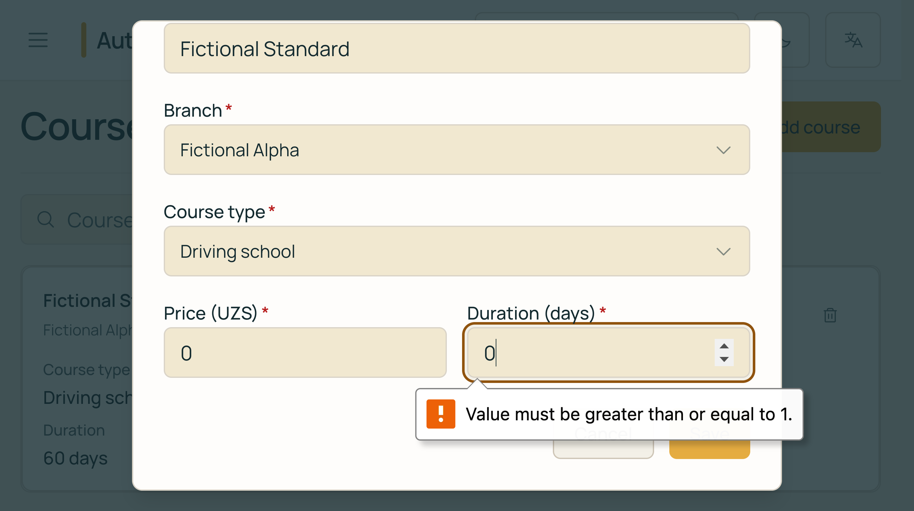
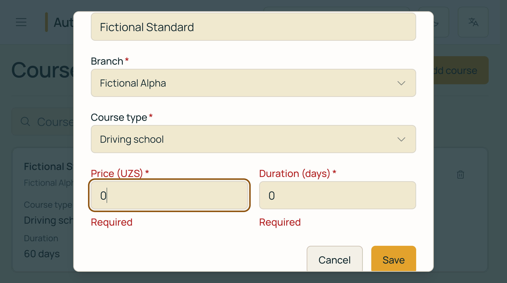

# Issue #323: localized course validation

Course duration zero now reaches the existing localized form resolver instead of stopping at Chromium's native range-underflow popup. Blank/zero fields still block submission. The handler suppresses native invalid behavior only for nonpositive duration underflow; positive fractional values retain the existing native whole-day constraint. Pricing, stored numeric amounts, duration units and minimum-duration policy remain unchanged. The unit labels added in PR #366 remain intact.

Independent old-base QA passed 1,406 tests on the logic-equivalent V1; a formatting-only AST-equivalent correction passed fresh 24-test/format checks. Types/lint/build/bundle and the actual generated `/courses` route passed. Browser checks covered UZ/RU/EN create/edit blank and zero values, fractions, numeric payloads, pending/repeated actions, failure/retry, dirty cancel/reopen, keyboard, restricted roles, both themes and responsive widths. Earlier harness/format/window failures remain in local evidence. Integration onto newer main and exact-commit CI are separate required gates.

No live API, database or production mutation was used. Actual screen reader and physical devices were not tested; accessible names/error associations do not establish spoken AT behavior or full WCAG acceptance. Shared validation announcements in #324 remain a separate task.

## Raw before/after screenshots

These unedited captures use synthetic data on the actual route. Their baseline is e57722d8 and tested source key99ff5122; later main's questions-only change does not alter the course form, shell, styles or configuration. Native Chrome 200% uses matching outer1440×893/inner720×403, DPR4, visual scale1 and root/body CSSzoom1. The dialog scrolls vertically; keyboard Tab brings Save into the viewport. No all-content-at-once claim is made.

### UZ — create

Before: 

After: 

### RU — edit

Before: 

After: 

### EN — create

Before: 

After: 
