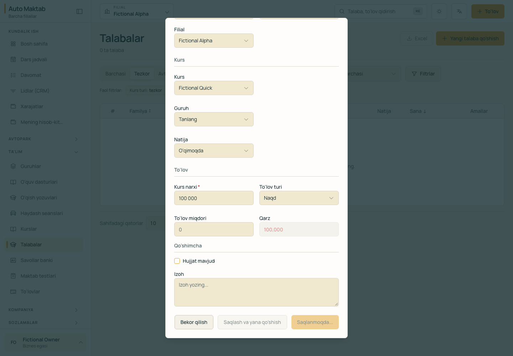
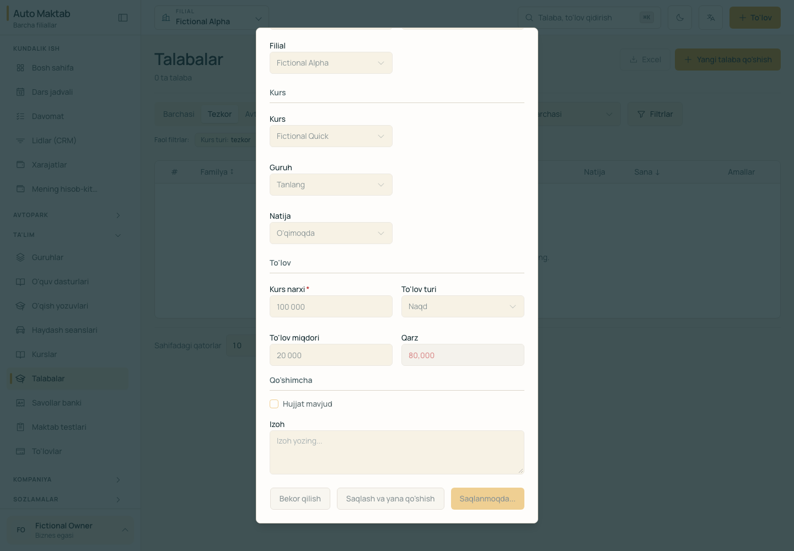
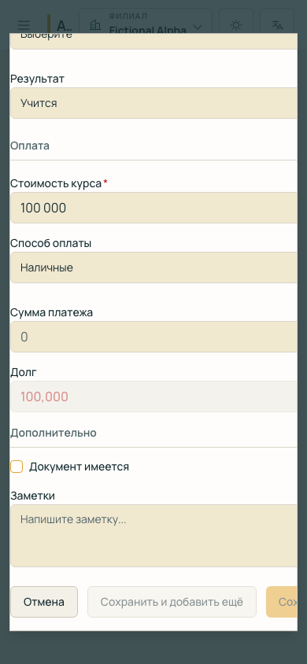
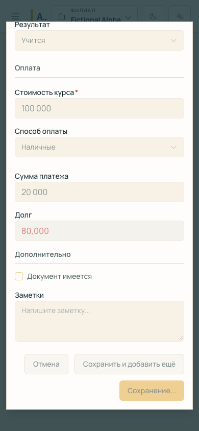
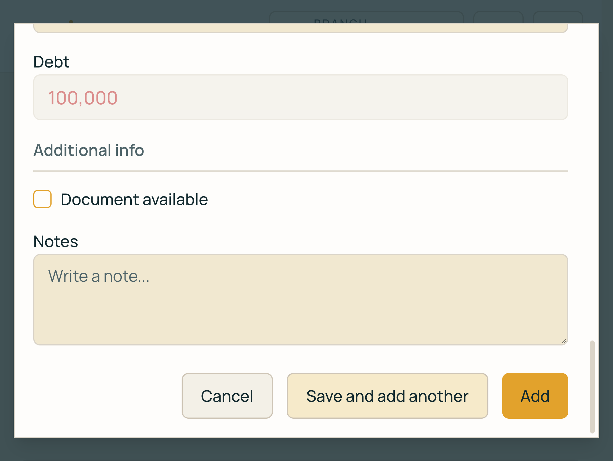
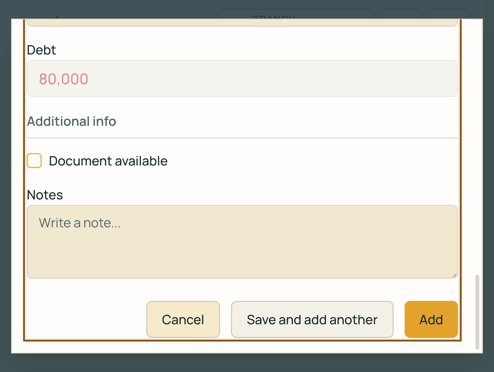

# Issue #342: preserve Save-and-add drafts until confirmed success

Before: frontend `8e70fd5d4d2c2e652b13e3c874d52f6f50db7d0b`. After source candidate: `e46dbe0e18847d98d565e77942dc2ebc03a2ea35acb9085fbec2cba77aab64f5`. Synthetic local data only; actual generated `/students` route, Chromium153.0.8010.12, unedited viewport PNGs. Before captures reuse the exact main archive; their default light appearance was visually observed without recorded theme-class metadata. After captures use the actual next-themes fixture with stored theme and html.dark recorded. No baseline candidate result is reused as an after PASS.

Save-and-add previously cleared the form before the create request completed. StudentsPage now returns the actual mutation promise through StudentsDialogs. StudentModal awaits that promise, retains the draft on rejection and resets once after confirmed success. A synchronous pending guard blocks repeated dispatch/dismissal, controls remain disabled while pending, and retired session/scope completions cannot reset a newer draft. Ordinary Save behavior remains separately tested. The footer wraps on narrow screens so all actions are visible.

| Scenario | Before | After |
| --- | --- | --- |
| Uzbek desktop, pending request: draft retained |  |  |
| Russian mobile emulation, 390px: visible pending footer |  |  |
| English native browser 200%: rejected draft retained |  |  |

Independent fresh verification:1,390 tests in222 files,21 focused tests, typecheck, lint, formatting, production synthetic build, bundle budget and diff checks passed. Real generated-route rejection/retry/pending/repeated-action/success/default-preservation/focus/permissions and retired actor/branch observations passed. All write requests were intercepted in memory before network forwarding; no production students, payments or enrollments were submitted.

Light/dark footer geometry passed at320/390/768/1024/1440 and native200. RU390 internal overflow improved from91px on baseline to0px; all action rectangles are fully visible. Native capture uses an owned browser profile, direct CDP whole-viewport screenshot with no clip/CSS zoom. Source/config hashes stayed unchanged and opaque environment files were restored. Cached React Doctor0.9.14 changed-scope diagnostics exited0 with no errors; structural and finite-test-fixture warnings were individually triaged, without an online score or unrelated refactor.

Limitations: unchanged40px button height is not a44px touch-target conformance claim. The rapid dirty-discard/reopen Detailed toggle lock matches baseline. A controlled-host browser session remained disabled until an old mutation settled; it does not prove typing a fresh draft before that callback, while the exact real-hook automated close/reopen race passed. Existing Quick `course_id` wire omission remains; selected course association, backend persistence/idempotency, payment/free-course/date policy and the rest of broad issue#342 are not fixed or accepted by this bounded change.
