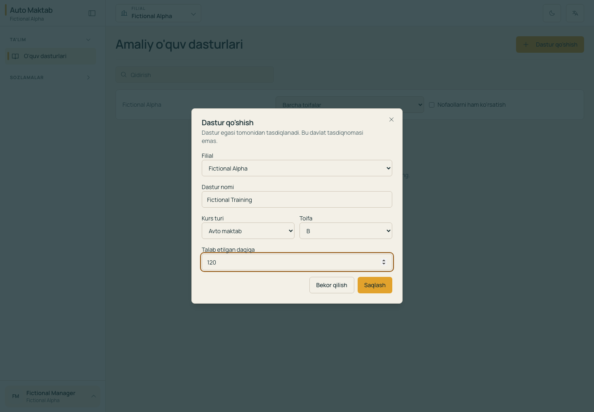
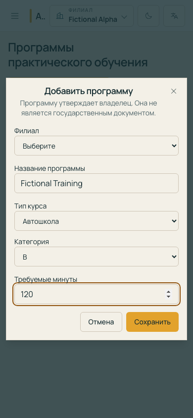
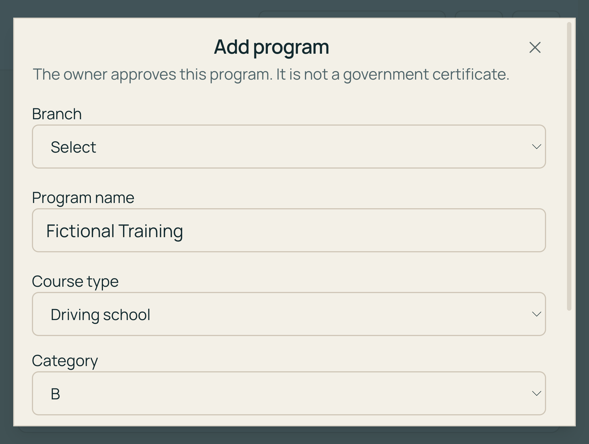
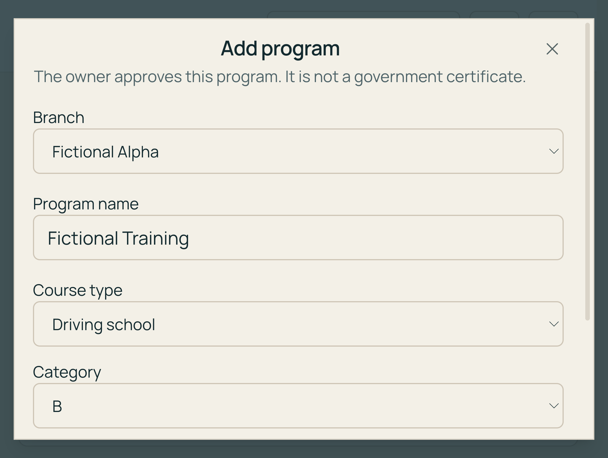

# Issue #344: authorized training program branches

Program creation now loads the existing write-options catalogue for training_programs/create. One permitted branch is selected automatically; multiple choices require selection. Loading/error/retry/empty states and current authorization are checked before submitting. A scoped create grant is independent of list/update context. Backend options support adds this resource without changing permission grants or policies.

createTrainingProgram sends the chosen branch in X-Branch-Id. The existing interceptor preserves an explicit nonempty string only for exact POST /training-programs; other requests retain existing active-branch behavior. Header/body conflicts remain available for backend rejection, and global active branch is unchanged.

Shared route admission is unchanged. Create-only A with active B still redirects to profile; this fix covers authorized active-branch routes and already admitted read-B/create-A shells. It does not broaden cross-context route admission.

Independent old-base QA: FE 1,410 tests plus types/lint0/format/build/bundle passed. BE focused26, types/lint0/format/ownership/build passed; its full local run retained1,007 passing tests and two socket-blocked failures, with separately passing12 unchanged HTTP tests. Actual generated-route fixtures covered selected header/body, grants/revocation, loading/empty/retry, pending/success/reopen, keyboard and both themes. New-main impact checks and exact commit CI are separate gates.

## Raw before/after screenshots

Unedited synthetic actual-route captures below are bound to old bases e57722d8/123d4035 and tested source keye59b4e6c. The later questions, course-validation and enrollment-list merges retain the program route and shell/styles. The new integration applies only the reviewed create-program header line over the merged enrollment getter; existing enrollment search remains intact. Fresh current-base impact checks and exact-commit CI are separate evidence. Native Chrome200% uses equal inner535×403/outer1070×893, DPR4, visual scale1 and root/body CSSzoom1. The dialog scrolls vertically; lower fields require scrolling. Earlier mismatched-window attempts are excluded and preserved locally.

These browser fixtures do not establish real backend/DB authorization, physical-device, spoken screen-reader or full WCAG acceptance. No production mutation occurred. Theme rendering was checked; no separate theme-toggle keyboard acceptance is claimed.

### UZ desktop

Before: 

After: 

### RU390

Before: 

After: 

### EN native200

Before: 

After: 
