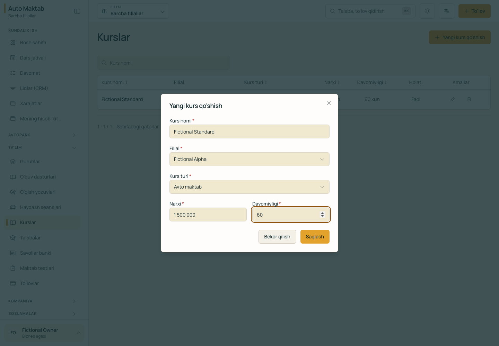
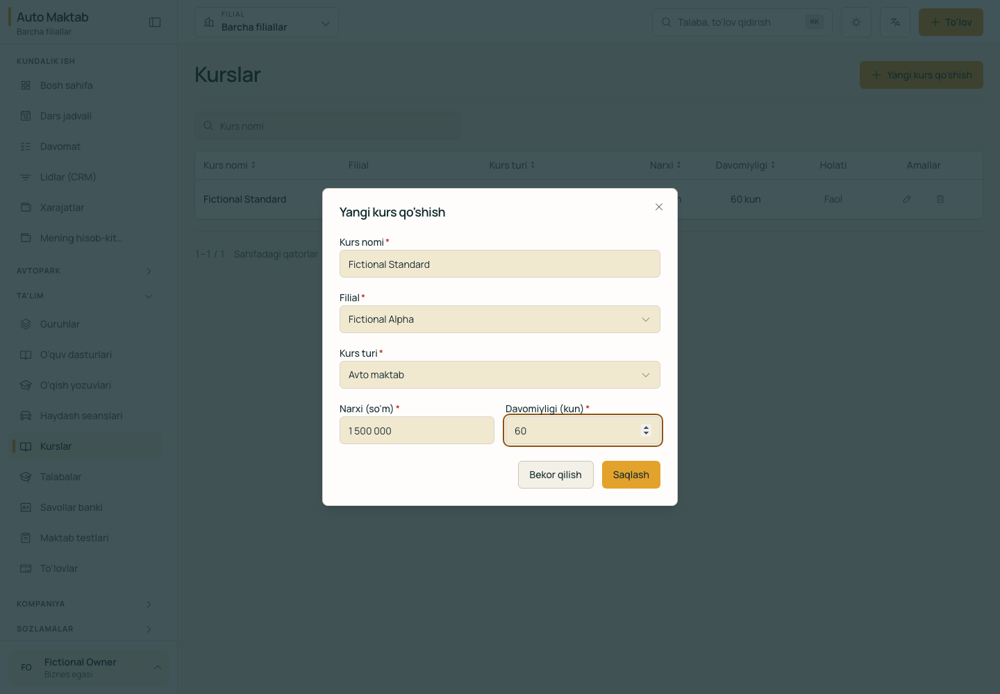
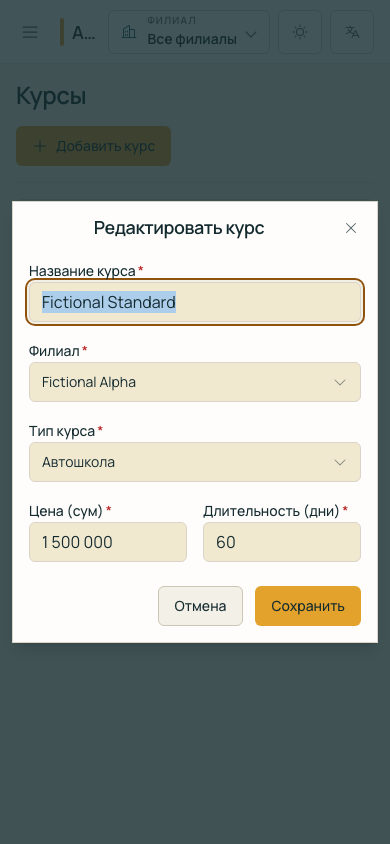
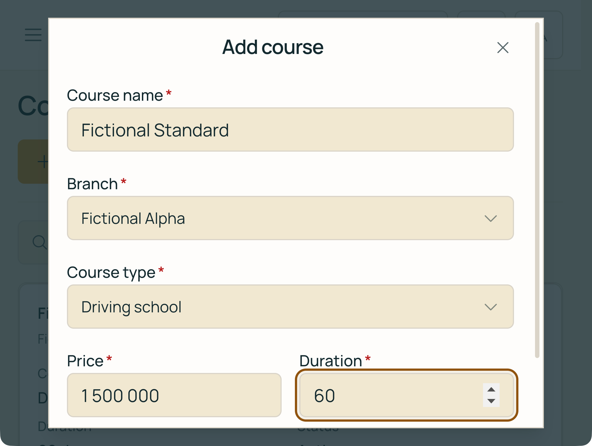
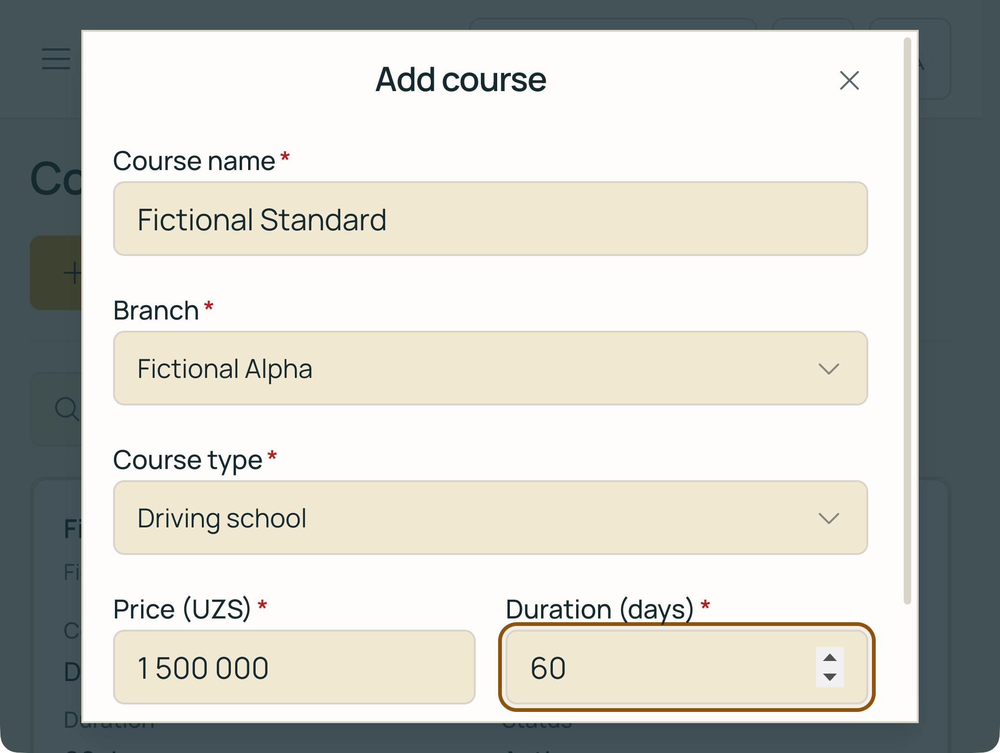

# Course form units — #323

Create and edit previously showed unitless price and duration labels. The associated labels now include UZS/so'm/сум and days/kun/дни in English, Uzbek and Russian. Generic list/detail translations and numeric values are unchanged.

## Exact candidate and checks

Before: `ef5e15834f6f72e17052172bc97e3a61a431211d`. After source snapshot: `3cae369c0859cd2f79e5bb49e556e26a3efdccb757923220c64738d81fb43fe8`.

Changed source: `CourseFormDialog.tsx` switches two translation keys; `en.json`, `ru.json`, `uz.json` each add two form-specific labels; `CourseFormDialog.test.tsx` adds 11 real-form assertions for associated labels, values, resolver errors, numeric payloads, scoped choices, dirty close, pending and error recovery.

Independent QA: 222 test files / 1,340 tests PASS; typecheck, lint with zero warnings, synthetic build and bundle check PASS. The focused form test passes 11/11. Each before/after phase covers 12 create/edit journeys across UZ/RU/EN and desktop/mobile, 18 validation/role/dirty/keyboard/pending/error checks, and six native 200% form checks.

Chromium `153.0.8010.12`, Node `24.20.0`, repository pnpm `11.17.0`. Fictional Standard, Fictional Alpha, price `1500000`, duration `60`; synthetic POST/PATCH intercepted in memory, with identical numeric payloads. Actual generated route, guards, form, hooks and CSS are used; external origins and other writes are blocked.

## Before / after

Raw unedited PNGs from the exact base and candidate. No production records, browser profiles or customer screenshots are used.

| Journey | Before | After |
| --- | --- | --- |
| Uzbek create, 1440×1000 |  |  |
| Russian edit, 390×844 |  |  |
| English create, native 200% |  |  |

Native zoom uses a fresh owned Chromium profile: inner 535×403, DPR 4, visual viewport scale 1 and CSS zoom 1; PNGs 2140×1612. The form scrolls within the dialog at this viewport; labels remain readable. No CSS scaling or image editing.

## Validation boundary

This is a labels-only fix. Existing required markers/aria-required, duration min=1/default step=1, resolver and payload semantics remain unchanged. Browser-native validation rejects zero and fractional duration before RHF inline errors; this existing limitation is recorded rather than described as a new localized-error fix. Blank/custom resolver errors are tested separately; direct jsdom submission does not prove native browser behavior. A separate course validation slice is needed for consistent localized duration errors; this PR does not claim #324 or every historical validation acceptance item is complete.

Permission fixtures establish observed scoped/no-write affordances, not new security policy. Browser evidence is synthetic integration, not live backend acceptance, a physical-device or screen-reader/WCAG audit. Two independent exact-snapshot reviews and final exact-commit CI are separate delivery gates. No merge or deployment is performed by this task.
