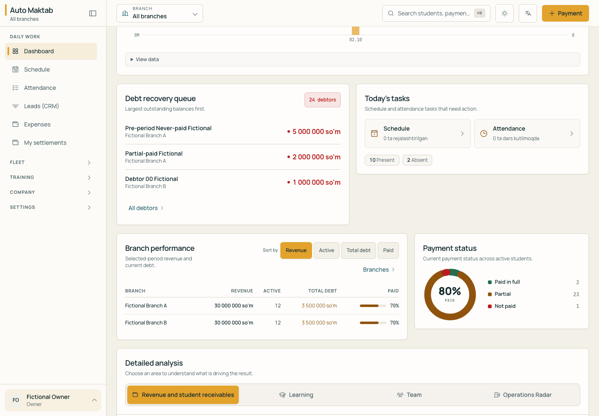
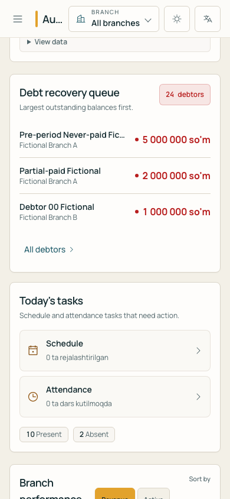
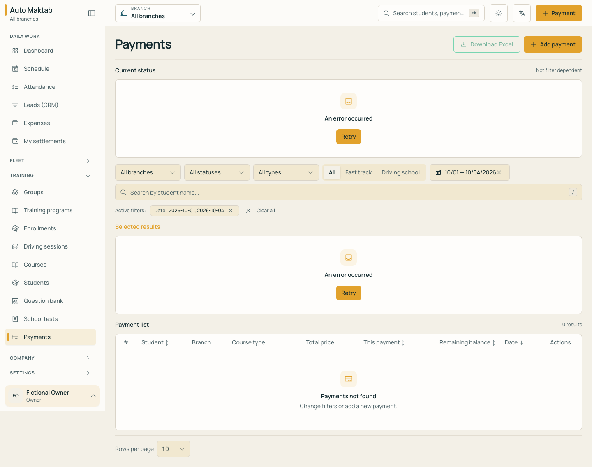
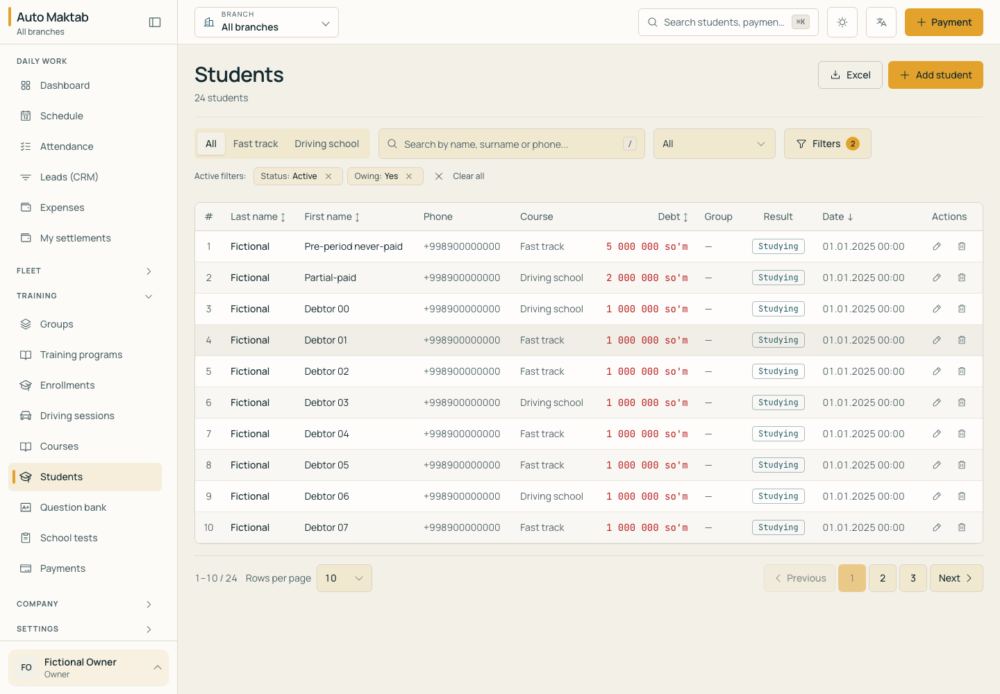
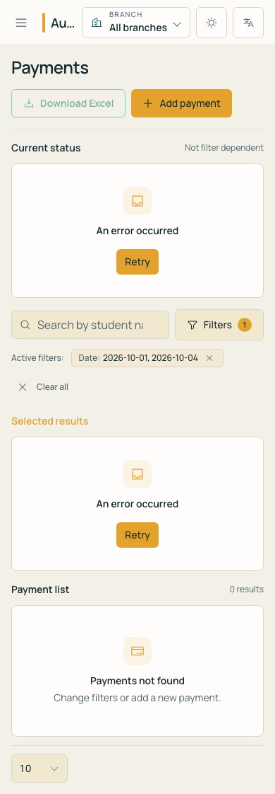
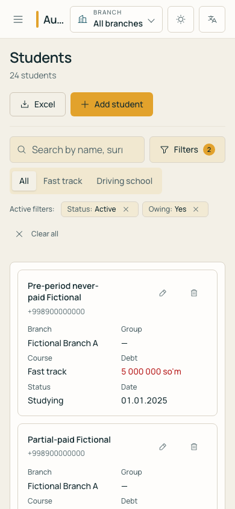
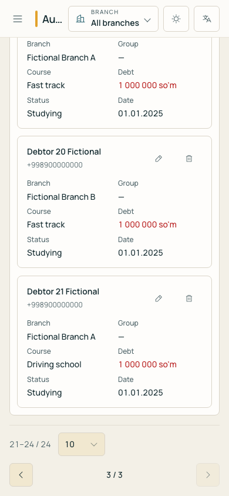
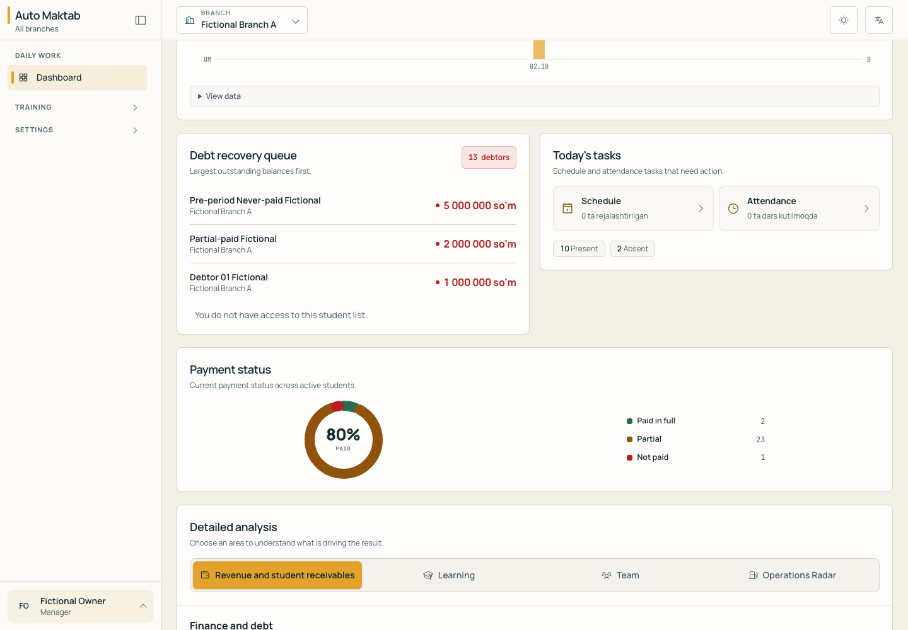
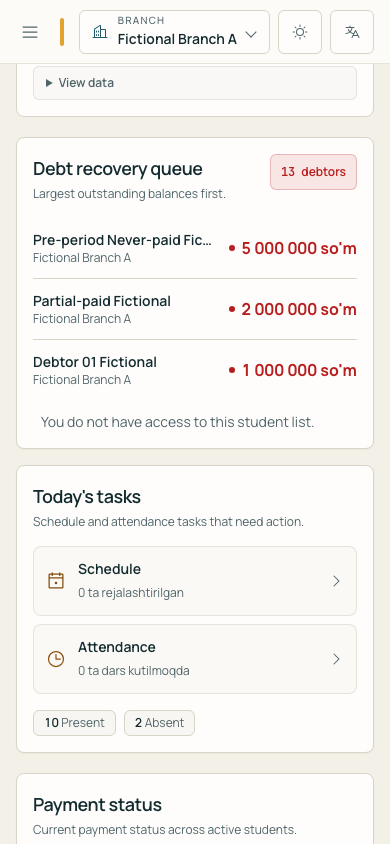

# Current debtor list — #345

The recovery queue's **All debtors** link previously opened payment history with the dashboard dates. It now opens the existing student list with `status=active` and `has_debt=true`, preserving the effective branch/course and omitting dates. This includes active debtors created before the selected period who have never paid.

The link requires `students.read` for its query scope. For ordinary roles, the destination's effective branch must also match that scope; otherwise translated guidance replaces the link. The dashboard now subscribes to active-branch changes so a mounted view refreshes its query. No API, route guard, permission, dependency or configuration changes.

## Real synthetic browser captures

All PNGs are unedited browser pixels. BEFORE is immutable frontend `5a70e9e208fccc549565b29dcd991136f381b511`; AFTER is that base plus six frozen source files, source digest `2dc69e2f18d6cba1c396a252e3bf143d67b52d325f9797adfa148ca3299238e5`. Chromium 153.0.8010.12, English/en-US, UTC, desktop 1440×1000 and mobile viewport emulation 390×844. These are emulated viewports, not physical-device captures.

Both versions use the same in-memory fictional population, including a never-paid student created on 2025-01-01, a partial payer, and paid/advance/suspended exclusion fixtures. The dashboard period is 2026-10-01–04. The primary actor is a fictional owner without a historical home branch. Only assigned loopback origins were allowed; other origins, WebSockets and service workers were blocked, and non-GET/HEAD API requests were rejected.

The queue's appearance is intentionally preserved; its destination changes. The BEFORE payment statistics show errors from unsupported mock endpoints. They demonstrate the wrong route/date chip, not a production payment error or a payment-statistics fix.

| View                             | Before                                                                 | After                                                                             |
| -------------------------------- | ---------------------------------------------------------------------- | --------------------------------------------------------------------------------- |
| Queue, desktop scrolled viewport |                 |                              |
| Queue, mobile scrolled viewport  |                   |                                |
| Destination, desktop full page   |  |                         |
| Destination, mobile              |     |  |

The mobile destination pair uses a BEFORE full-page capture and an AFTER top viewport. Offscreen student cards use existing `content-visibility`; full-page captures can leave them unpainted. The actual scrolled viewport above shows the first debtor, and the capture below shows page 3 and `21–24 / 24`, without CSS or image edits.

Denied `students.read` shows nonnavigating guidance for a fresh manager in Branch A:

| Desktop                                                    | Mobile                                                   |
| ---------------------------------------------------------- | -------------------------------------------------------- |
|  |  |

## Verification

A separate Tester passed 20 browser scenarios using real generated TanStack routes/guards, components, hooks, stores, serializers and CSS with mocked backend responses. Coverage includes nine owner All/A/B × All/fast-track/driving-school combinations, mounted branch changes, denied/revoked/scoped grants, hostile manager URL, explicit/global branch mismatch and recovery, loading/error/empty states, keyboard Tab/focus/Enter, search resetting pagination, deep-link/reload, and back/forward. The server-response mock returns total 24 with pages 10/10/4 and a unique 24-ID union; never-paid and partial-paid rows remain included. Observed neighboring payment/KPI/individual-row links are unchanged.

Independent executable checks on the frozen source all passed: 216 test files / 1,242 tests, typecheck, lint with zero warnings, synthetic production build and bundle budgets. Node 24.20.0 and repository pnpm 11.17.0; the initial QA version metadata was measured in the task root, corrected by measuring the application cwd used by every check. Original harness calibration failures and corrected final retests are retained in local evidence. Implementer focused tests: 53 passed. Changed-scope cached React Doctor exited 0 with one existing dashboard complexity warning; no numeric health score or supply-chain check is claimed.

Synthetic evidence does not establish live backend/RLS, balances, physical-device behavior or full WCAG conformance. Backend contract inspection is pinned to `95adc976e55aa9fe396c0f4d672e716188b758e4`.

## Preserved boundaries

Historical-home All semantics remain a separate issue: owner All with home A still queries dashboard A and this CTA follows A; fresh ordinary-role All does not enable company-wide student fetching, and the CTA fails closed. Existing owner explicit URL/global branch conflicts can also be rejected by the backend header/query consistency guard; the owner matrix here uses active branch null and is not a universal live authorization claim. Debt KPI dates/permissions and individual-row authorization are outside this fix.

## Capture provenance

Each timestamp is UTC on 2026-10-04. The AFTER mobile content captures use the same frozen source and fictional population as the paired run. Denied captures use the fresh manager described above.

| File                                     | UTC time                 | Capture                         | SHA-256                                                            |
| ---------------------------------------- | ------------------------ | ------------------------------- | ------------------------------------------------------------------ |
| `before-queue-viewport-1440.png`         | 2026-10-04T02:46:59.335Z | scrolled actual viewport pixels | `f43b5567fad99704327ac973ab66c688664d3ab44f962ccfd187b5515b57c51f` |
| `after-queue-viewport-1440.png`          | 2026-10-04T02:48:02.375Z | scrolled actual viewport pixels | `f43b5567fad99704327ac973ab66c688664d3ab44f962ccfd187b5515b57c51f` |
| `before-queue-viewport-390.png`          | 2026-10-04T02:47:03.860Z | scrolled actual viewport pixels | `5db6d402e76714776a3aea8dceb7ccd42d05e36eb9bb37b19f76c529949db1af` |
| `after-queue-viewport-390.png`           | 2026-10-04T02:48:06.753Z | scrolled actual viewport pixels | `5db6d402e76714776a3aea8dceb7ccd42d05e36eb9bb37b19f76c529949db1af` |
| `before-destination-1440.png`            | 2026-10-04T02:47:01.113Z | full-page actual browser pixels | `d30a34877590505916b83e2058b41a5b1bd2e3756618ec21b93146737564933f` |
| `after-destination-1440.png`             | 2026-10-04T02:48:04.112Z | full-page actual browser pixels | `306cb47329b31dba1a18d63b3691c9bea39c8a6865cb2980ca98de35349208af` |
| `before-destination-390.png`             | 2026-10-04T02:47:05.621Z | full-page actual browser pixels | `99e839071e902b62c8d6e471a6d21c667c7bb90569a981ca4c131ee90481686a` |
| `after-students-mobile-viewport-top.png` | 2026-10-04T02:52:33.821Z | scrolled actual viewport pixels | `610f1f978e16e1b96c23a13c2df17ef178cda6388e87629441170582e6a9f0ed` |
| `after-students-mobile-page3.png`        | 2026-10-04T02:52:37.093Z | scrolled actual viewport pixels | `9b65a8db73db188d7c0d28482340eed77785d81713450590eea1153243615048` |
| `after-denied-viewport-1440.png`         | 2026-10-04T02:55:33.965Z | scrolled actual viewport pixels | `e44d41d153beaa8890bfc1edb9f95b81b47d5e24c596657c98772b6afc966b7e` |
| `after-denied-viewport-390.png`          | 2026-10-04T02:55:38.323Z | scrolled actual viewport pixels | `b2be84cf79ef95a3521f3d86ba83a047db197498a5672824b8272a71ec8c9d96` |
