# Dashboard business dates — #361

Selected October 1–3 business dates previously rendered a September 30 start in UTC/Los Angeles. The trend range, axis, tooltip, peak and expanded table now use the existing Asia/Tashkent helpers. Full date details retain the year and use UZ/RU/EN localization. Previous-period display uses its inclusive end, or exclusive end minus one millisecond. Current display prefers inclusive metadata, then the exclusive period/ISO filter end; a date-only fallback keeps its calendar meaning. Queries, bucket order, amounts, payment counts and existing navigation are unchanged.

BEFORE is frontend main `5802e0f46130eb8267618b4d662e02424b5d227e`, including externally merged PRs #362–364. AFTER is frozen source digest `7d253a0973cf31d24a4a56fe114953bd12988174df0ae42bb814b476c3530182`. Each image is an unedited, byte-identical PNG from a separate Tester using generated routes, real components/hooks/axios/CSS and in-memory `business-midnight-v2` fixtures with a fictional owner. No live API, production data or payment/enrollment mutation was used.

All five repository checks passed: 221 test files / 1,329 tests, typecheck, lint with zero warnings, synthetic build and bundle budgets. The two focused files passed 60 tests in UTC, Asia/Tashkent and America/Los_Angeles. Twenty-five fresh browser scenarios plus keyboard/touch, loading/error/empty, actual serialized query/value/order and drilldown checks passed. These are local synthetic results; exact-head CI is reported in the PR.

Chromium `153.0.8010.12`. Desktop viewport 1440×1000, mobile 390×844 and reflow 320×844 at 100% browser zoom. Full-page PNG height differs from configured viewport height. Native 200% captures use a fresh task-owned profile: actual outer window 1070×893, CSS viewport 535×403, DPR4, visual scale1 and root/body CSS zoom1. The environment constrains the requested native window width; these are actual measured dimensions. Native viewport PNGs are 2140×1612, captured without image or CSS editing. Keyboard focus/Enter/Space and touch emulation passed; physical devices, screen readers, full WCAG and live backend/RLS were not exercised.

## Uzbek October range and chart, UTC, desktop1440

| Before                                    | After                                   |
| ----------------------------------------- | --------------------------------------- |
| 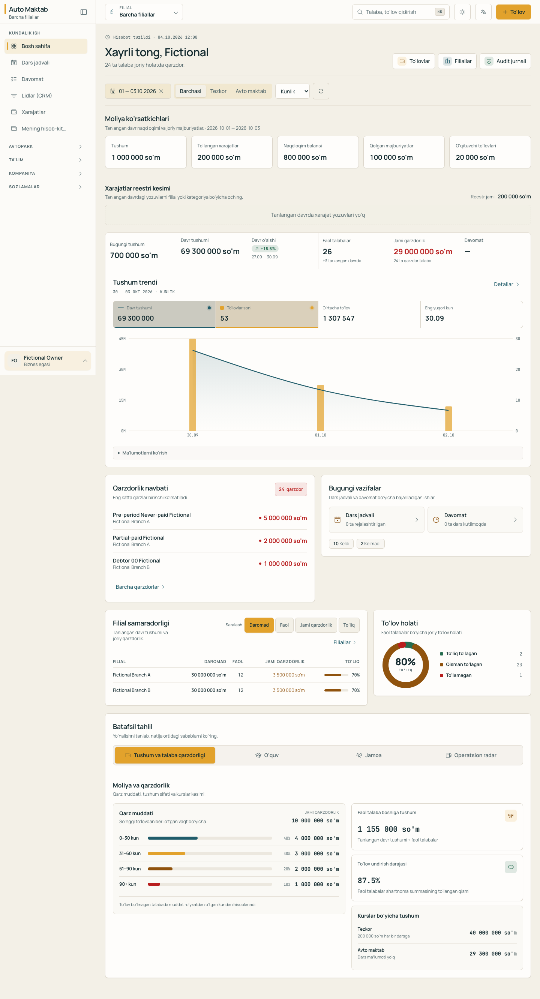 | 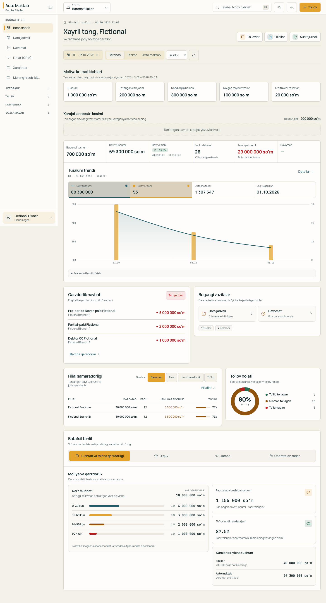 |

BEFORE: 2026-10-04T04:01:14.661Z; UI uz, browser locale uz-UZ, timezone UTC; CSS 1440×1000, 100% zoom; PNG 1440×2664. SHA256 `4436d20b28e43e8a1250171e9fa2550648a45ed703f1931e138ab525c73d64e3`.

AFTER: 2026-10-04T04:06:42.096Z; UI uz, browser locale uz-UZ, timezone UTC; CSS 1440×1000, 100% zoom; PNG 1440×2664. SHA256 `e56d9e21d8b9f24bdc6b324537fb1564a9dff6d43b1f07bd2c62bb78ac90fd71`.

## English October tooltip, Los Angeles, desktop1440

| Before                                                            | After                                                           |
| ----------------------------------------------------------------- | --------------------------------------------------------------- |
|  | 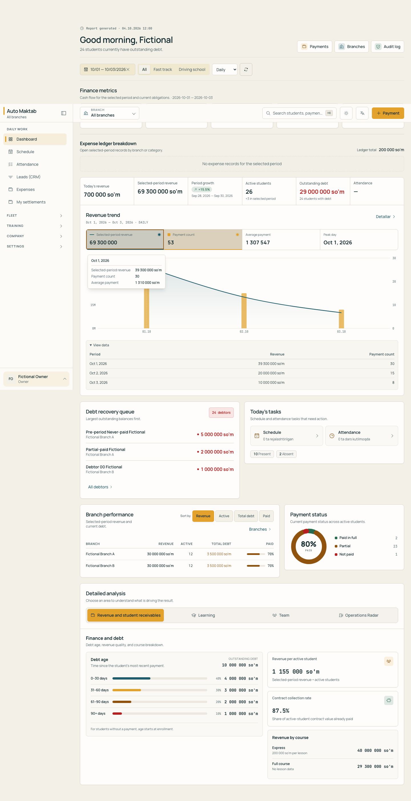 |

BEFORE: 2026-10-04T04:01:59.229Z; UI en, browser locale en-US, timezone America/Los_Angeles; CSS 1440×1000, 100% zoom; PNG 1440×2803. SHA256 `15d9f1b560b550d245289cb230ae2c14098c78225a37fe846cbfea86672e6c3d`.

AFTER: 2026-10-04T04:07:27.346Z; UI en, browser locale en-US, timezone America/Los_Angeles; CSS 1440×1000, 100% zoom; PNG 1440×2803. SHA256 `ce452976a26ae873e1276a48180b6f5ac5436897a24c7bc243b07451fde7db10`.

## Russian cross-year expanded table, mobile390

| Before                                      | After                                     |
| ------------------------------------------- | ----------------------------------------- |
| 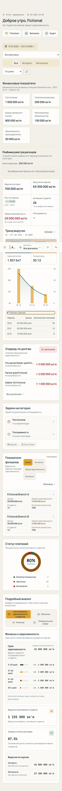 | 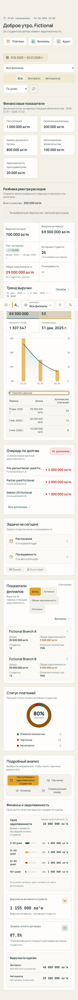 |

BEFORE: 2026-10-04T04:02:53.872Z; UI ru, browser locale ru-RU, timezone UTC; CSS 390×844, 100% zoom; PNG 390×4914. SHA256 `7c19c0db7fdb7b18d80e71a9986f5403ab90e472150a0f856047a67a7efe8a6c`.

AFTER: 2026-10-04T04:08:22.548Z; UI ru, browser locale ru-RU, timezone UTC; CSS 390×844, 100% zoom; PNG 390×5000. SHA256 `657e503aa6a73b1d61e9aa4e409a07652a901d5b9ed4ca427523919f82b8b8b2`.

## English cross-year table, effective320CSS

| Before                                      | After                                     |
| ------------------------------------------- | ----------------------------------------- |
| 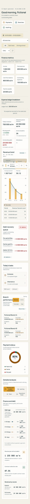 | 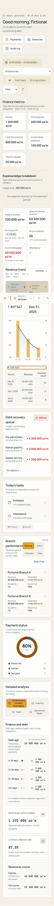 |

BEFORE: 2026-10-04T04:03:13.984Z; UI en, browser locale en-US, timezone UTC; CSS 320×844, 100% zoom; PNG 320×5171. SHA256 `44fd169a13b6b93c2d34bd554fa27f77975955e6f2b875011c91fac61d05d4d4`.

AFTER: 2026-10-04T04:08:46.261Z; UI en, browser locale en-US, timezone UTC; CSS 320×844, 100% zoom; PNG 320×5269. SHA256 `204c71afced3bf26e10975ec6a7f991c11ab20be70fa02d4470a2f6ed2a16bb5`.

## Russian cross-year caption and peak, actual200%browserzoom

| Before                                       | After                                      |
| -------------------------------------------- | ------------------------------------------ |
| 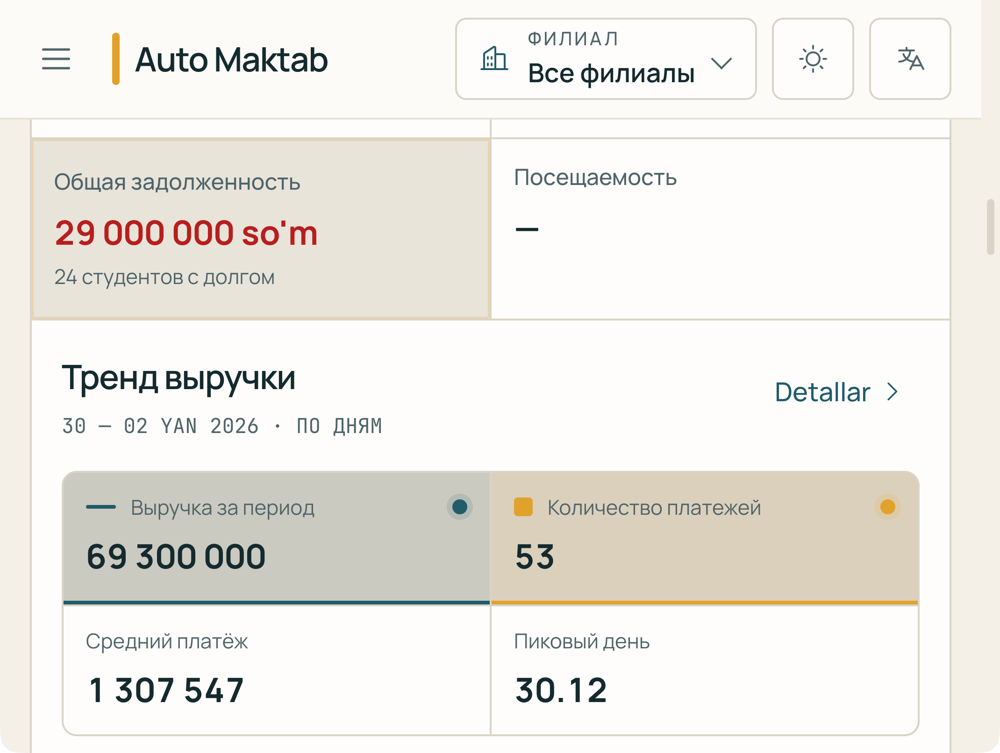 | 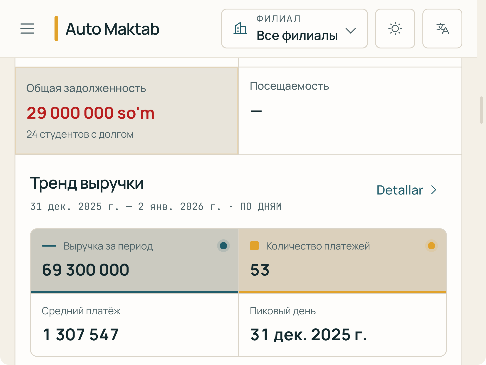 |

BEFORE: 2026-10-04T04:03:01.434Z; UI ru, browser locale en-US, timezone UTC; CSS 535×403, 200% zoom; PNG 2140×1612. SHA256 `e54d2e9dd54546cf9b0cd7b43a6c52064c730691caba4e4d740455900df9b21b`.

AFTER: 2026-10-04T04:08:30.812Z; UI ru, browser locale en-US, timezone UTC; CSS 535×403, 200% zoom; PNG 2140×1612. SHA256 `10ea23da0ee1ce8c99bedd4d02d4b8b6ce5fa5e358c06df3e563745e50952aec`.

## English cross-year table, actual200%browserzoom

| Before                                     | After                                    |
| ------------------------------------------ | ---------------------------------------- |
| 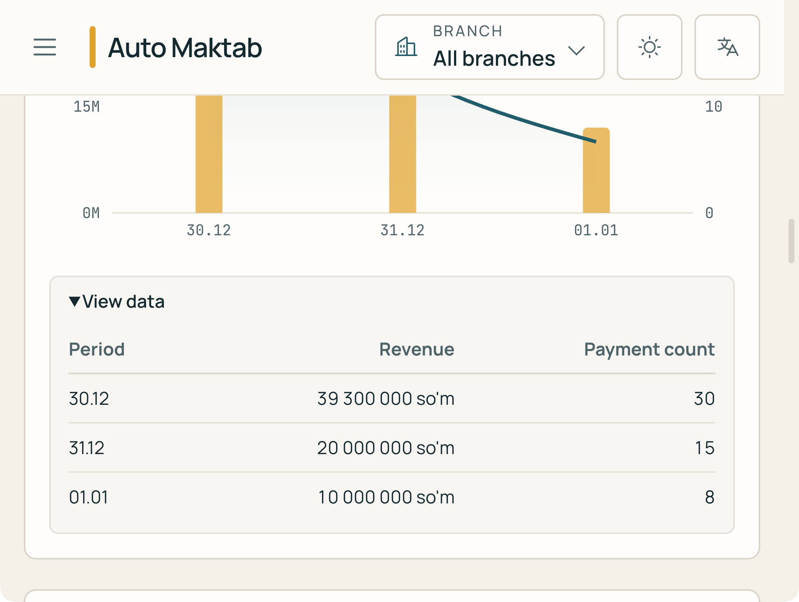 | 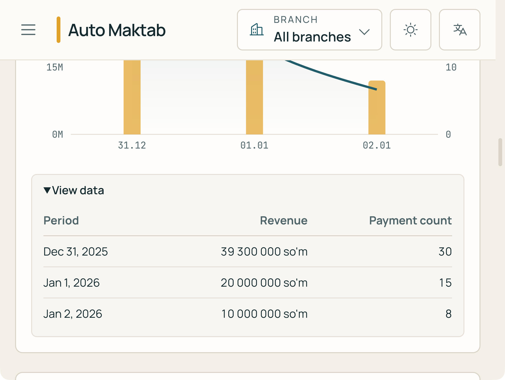 |

BEFORE: 2026-10-04T04:01:30.726Z; UI en, browser locale en-US, timezone UTC; CSS 535×403, 200% zoom; PNG 2140×1612. SHA256 `ca56a2bf3f6785bc709898715e68985ee66890705926198443e399a413c0f425`.

AFTER: 2026-10-04T04:07:03.618Z; UI en, browser locale en-US, timezone UTC; CSS 535×403, 200% zoom; PNG 2140×1612. SHA256 `6bd7db64b5ddb020a68c4e8d75388aac11e6f16c12f49809cdc4848136bbf1ed`.
