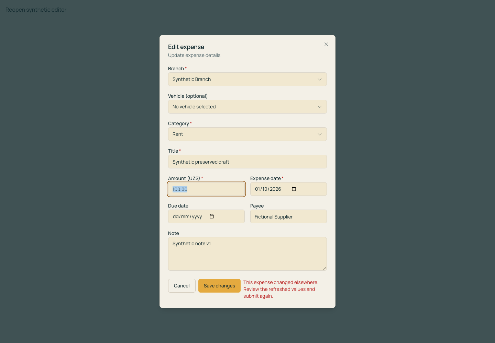
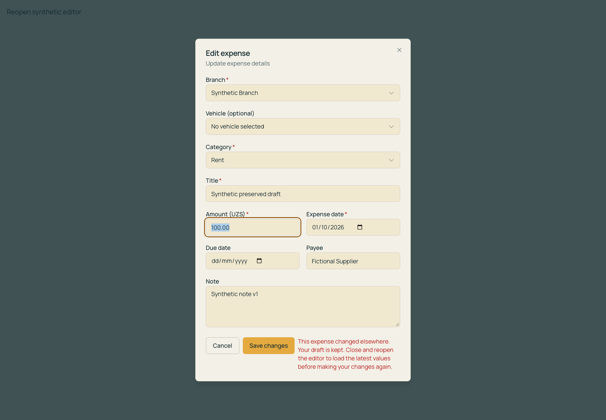
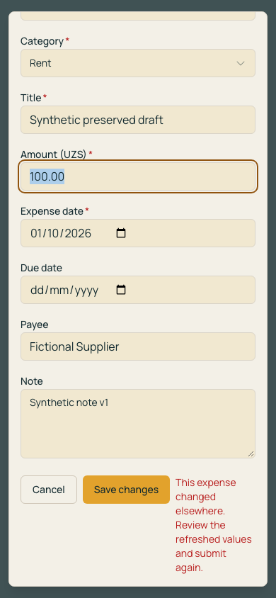
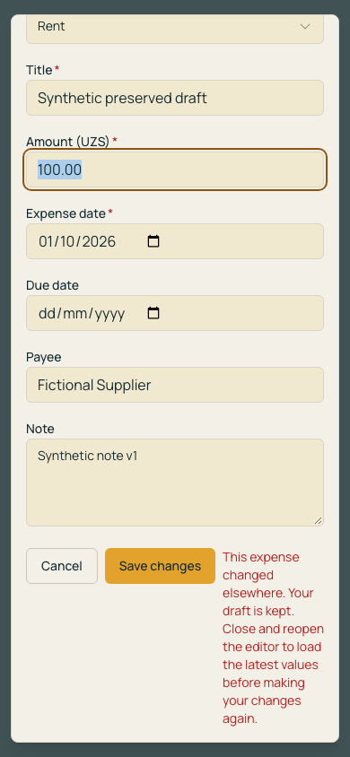
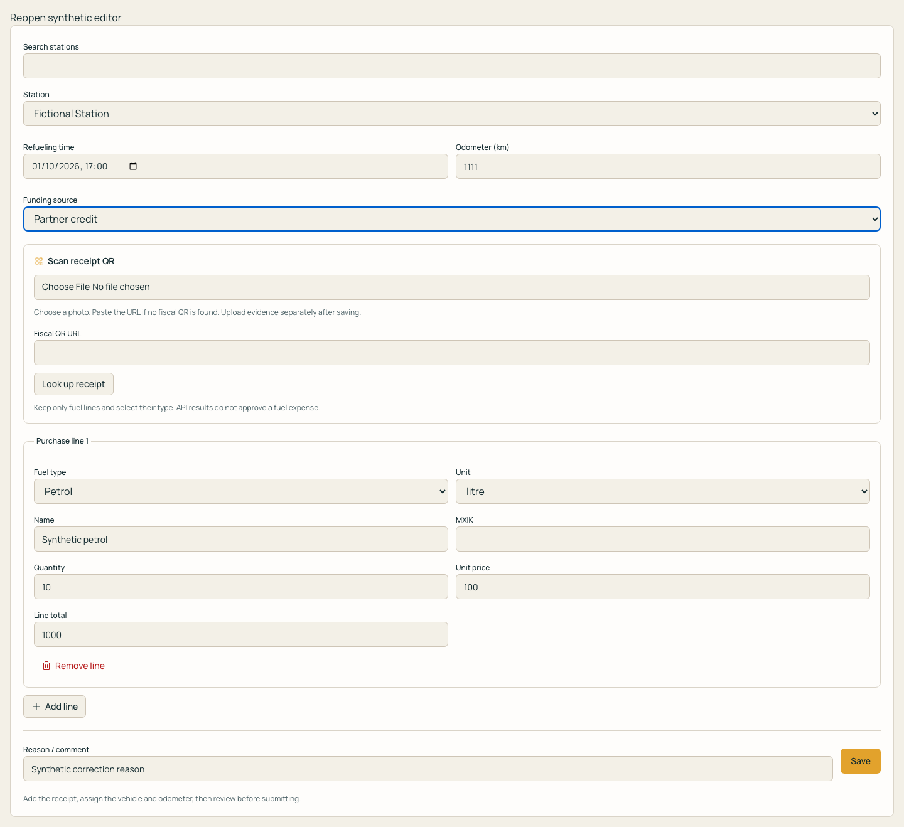
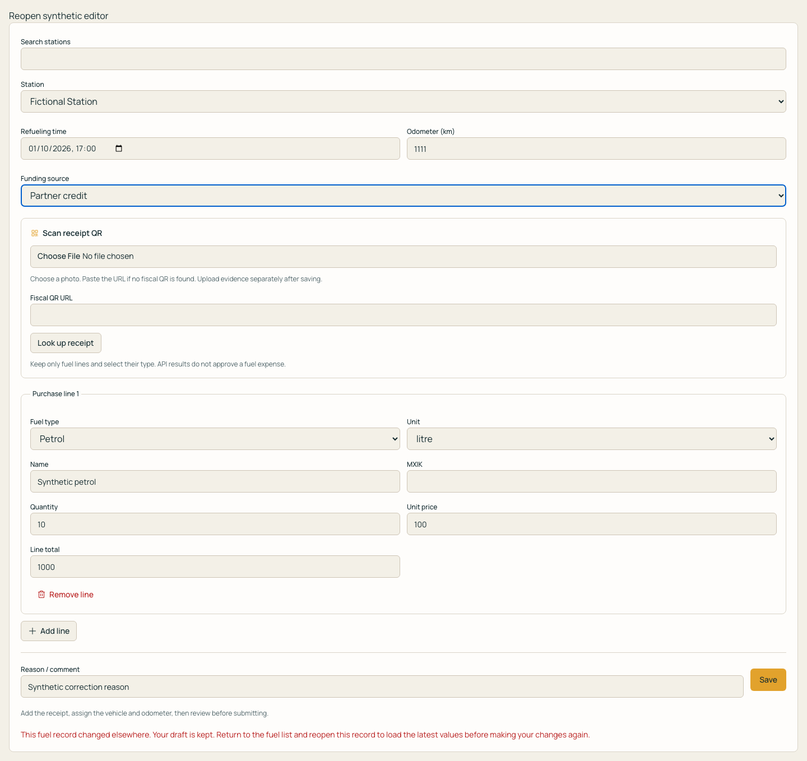
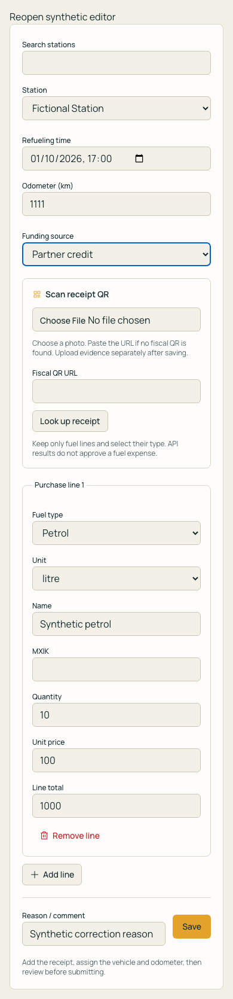
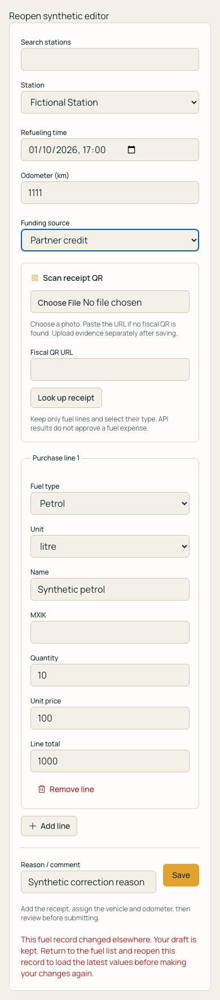

# Expense and fuel editor version safety

Refs #349. Same-record background updates previously changed the version sent by an existing draft. A stale edit could therefore submit against a version the user had never reviewed.

The edit session now retains its initial values, record identity and version. A 409 keeps the draft and original version, with explicit recovery guidance. Discard/reopen, remount or a new record starts a fresh session. A successful fuel save advances the mounted session only to the acknowledged response version, preserving input typed while saving; unrelated background responses cannot advance it. Live financial locks, fuel eligibility and pending-action guards still apply.

## Exact changes

- `src/features/expenses/components/ExpenseFormDialog.tsx`: session baseline, current financial-lock checks at dispatch, retired/pending callback guards and conflict recovery.
- `src/features/expenses/components/ExpenseFormDialog.baseline.test.tsx`: background updates, conflicts, reset boundaries, pending/retired validation and live financial locks.
- `src/features/vehicles/fuel/FuelForm.tsx`: record-keyed draft and version, acknowledgement-only advancement, pending/retired guards and inline recovery.
- `src/features/vehicles/fuel/FuelForm.baseline.test.tsx`: original-token retries, fresh sessions, successful continuation, later input and retired responses.
- `src/features/vehicles/fuel/FuelDetailPage.tsx`: coordinate correction activity with lifecycle actions and retain live eligibility checks.
- `src/i18n/locales/{en,ru,uz}.json`: recovery guidance.
- This README and eight unedited PNG copies document the requested before/after evidence. No API, dependency or infrastructure changes.

## Validation and provenance

Separate Tester: 218 test files / 1,251 tests passed, plus typecheck, lint with zero warnings, synthetic build and bundle budgets. Test run UTC 2026-10-04 02:09:31–02:13:15; all five gates completed by 02:13:47. Focused implementation run: 89 tests in seven suites. Browser evidence: 60 result assertions plus one source snapshot invariant passed; this count does not represent 61 distinct journeys.

Chromium 153.0.8010.12 ran the real forms, detail page, hooks and axios serializers against in-memory responses. Desktop viewport 1440×1000 and mobile viewport emulation 390×844; fictional branch, supplier, station and records. All other origins, WebSockets and service workers were blocked. No live backend, production writes, uploads or physical-device testing.

BEFORE is immutable main `5a70e9e208fccc549565b29dcd991136f381b511`. AFTER source SHA-256 is `5326984fe2ae1a30998c9c245e67411642f9d8f26b61d704b9d349a13fae303e` (eight application/test/locale files). The separately labeled harness diagnostic panel was hidden for product screenshots; product controls were untouched. Mobile expense captures scroll to the complete actions and recovery text. Fuel captures wait for natural toast expiry with the pointer moved away. PNG pixels were not edited.

| Pair                       | BEFORE journey completed, UTC | AFTER journey completed, UTC |
| -------------------------- | ----------------------------- | ---------------------------- |
| Expense, 1440x1000         | 2026-10-04T02:00:42.332Z      | 2026-10-04T02:10:12.904Z     |
| Expense, 390x844 emulation | 2026-10-04T02:00:42.332Z      | 2026-10-04T02:10:12.904Z     |
| Fuel, 1440x1000            | 2026-10-04T02:00:55.426Z      | 2026-10-04T02:10:25.900Z     |
| Fuel, 390x844 emulation    | 2026-10-04T02:00:55.426Z      | 2026-10-04T02:10:25.900Z     |

## Matched screenshots

These screenshots show preserved drafts and recovery. Hidden version behavior is established by captured real PATCH bodies: BEFORE incorrectly used version 2 after a background update; AFTER retained version 1 across repeated 409s. Separate success evidence verifies first fuel PATCH version 1 → acknowledged version 2 → second PATCH version 2, with later odometer 1112 retained despite an injected unrelated cache version 99.

### Expense, desktop

BEFORE keeps the draft but advises retry after silently promoting its version.

AFTER keeps the same draft and original version, explaining close/reopen recovery.

### Expense, mobile

The matched bottom-of-dialog views include Cancel, Save and the complete conflict text.

### Fuel, desktop

BEFORE has no persistent inline conflict recovery. AFTER retains the same correction values, request identity and original version with list/back-return guidance.

### Fuel, mobile

The full-page captures include the correction reason, Save and the complete recovery text.

## Limits and separate observation

Mock responses establish UI behavior and serialized requests, not live ledger or database persistence. The injected cache version 99 is adversarial client data, not a claim that the backend permits overwriting server version 99. Other browsers, physical devices and full screen-reader conformance were not tested.

A separate existing station-option observation occurred on both BEFORE and AFTER: receiving an identical fetched station option can make the native select display Choose while the form/request retains the station ID. This change does not fix that issue. Both final screenshot fixtures use an empty station list, retaining the historical Fictional Station label consistently. Earlier candidate and capture attempts remain in the local QA evidence; only the corrected source above is the final tested candidate.
