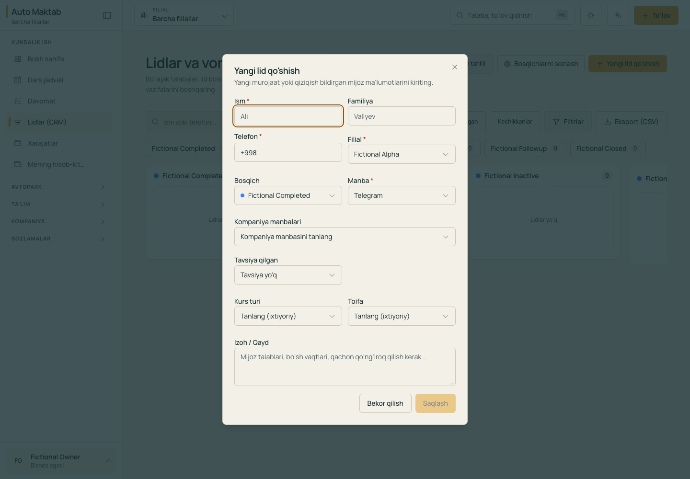
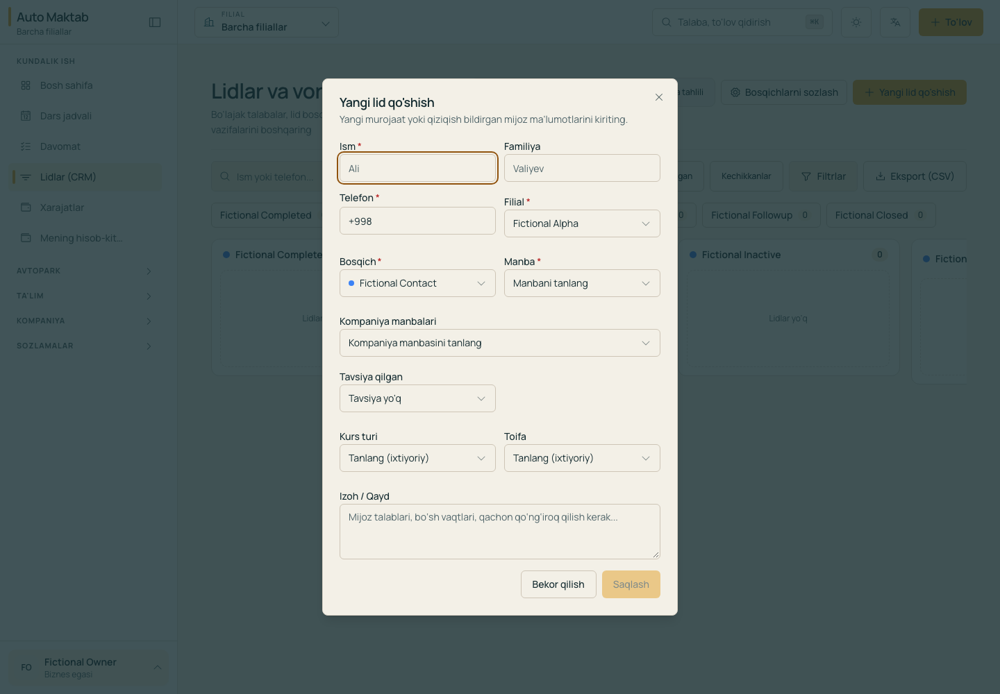
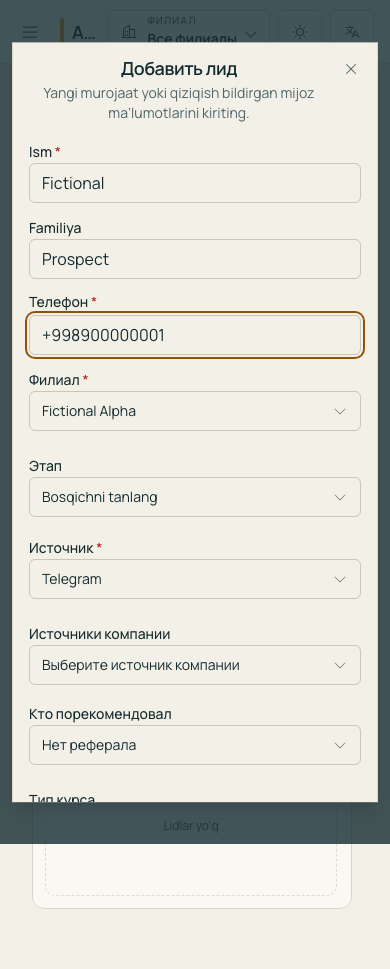
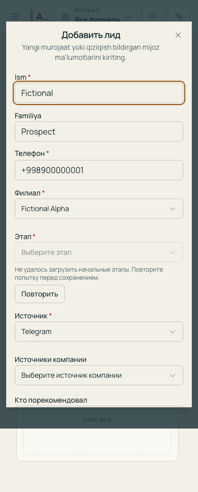
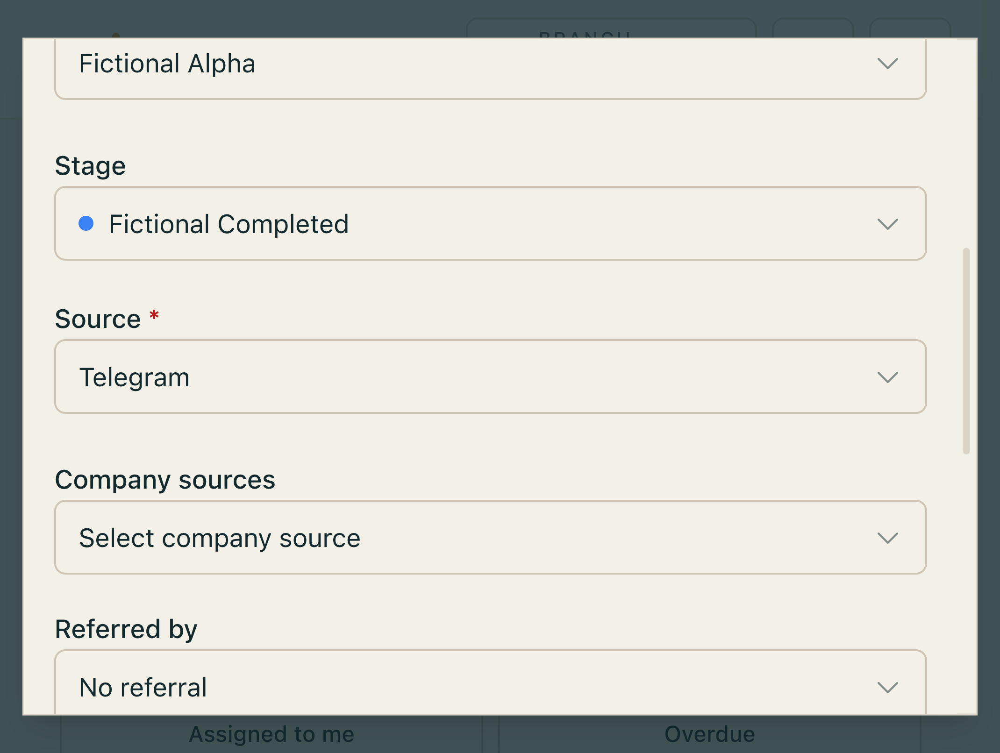
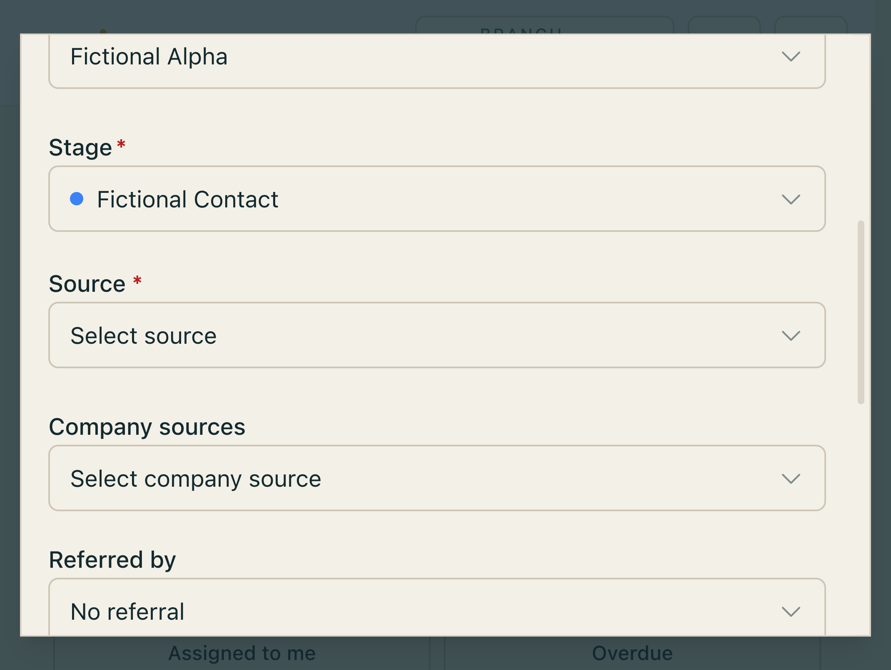

# Lead source and initial stage safety — #347

New leads now start with a blank, required source. The operator deliberately selects an existing source or company source; existing wire enum and custom-source mapping are preserved. Create choices include only active initial stages supported by the backend. An invalid default resolves to the first eligible stage; a deliberately selected stage that disappears requires fresh selection. Loading, refresh, error, empty and retry states block unsafe creation and explain recovery in UZ/RU/EN.

Cancel, dismissal and controlled close/reopen reset the local draft. A pending request blocks ordinary dismissal and repeated dispatch; retired open-cycle callbacks cannot close a newly opened draft. A failed request preserves the current draft. These client guards do not establish backend idempotency or real persistence.

## Exact change

- `src/features/leads/components/CreateLeadDialog.tsx`: required blank source, eligible stage choices and query-state feedback, aligned submit guards and local draft lifecycle. A real Radix loading recovery regression rejects noneligible empty selection events without replacing a removed explicit choice.
- `src/features/leads/components/CreateLeadDialog.test.tsx`: real dialog/locale tests, actual Radix regression, query states, defaults, reset, pending and retired callbacks.
- `src/features/leads/api/leadsApi.test.ts`: actual Axios adapter request body/path assertions for existing source enum and alias mappings.
- `src/i18n/locales/{uz,ru,en}.json`: seven new placeholders and initial-stage status messages per locale; every existing value remains unchanged.

## Real synthetic before/after evidence

Captured on 2026-10-04 UTC with Chromium153.0.8010.12, actual generated `/leads` route, providers, guards, query hooks, API mapping and CSS. Baseline `bd82421e61eb69c36105b0c02c14f1eb6983663d`; candidate six-source-file digest `1140c5439693b8e21ea0d451e0663b2546da6e770288d217c35a042cd6fd782b`. Fixtures contain fictional Alpha/Beta branches, active Contact/Followup stages, inactive and terminal/legacy stage records and a fictional custom source. PNGs are raw and copied byte-identically; no annotations, editing or stitching. Lead POST responses are intercepted in memory; other writes and external origins are blocked. No production lead or other record was submitted.

| Case                                           | Before                                   | After                                            |
| ---------------------------------------------- | ---------------------------------------- | ------------------------------------------------ |
| UZ desktop, 1440×1000, fresh create            | Terminal Completed and implicit Telegram | Eligible Contact and explicit source placeholder |
| RU mobile, 390×844 viewport, query error       | No stage recovery explanation            | Localized prerequisite error and Retry           |
| EN native 200%, scrolled stage/source controls | Terminal Completed and implicit Telegram | Eligible Contact and explicit source placeholder |

UZ desktop before/after, captured05:46:22 /05:52:20 UTC:

RU mobile error before/after, captured05:46:32 /05:53:09 UTC. Raw full-page PNGs390×969; this does not replace the actual390×844 interaction checks. Newly added stage copy is localized; inherited mixed-language name/description copy remains outside this slice.

EN native200% before/after, captured05:53:10 /05:54:55 UTC. Fresh owned headed Chromium profile with native zoom preferences, no device emulation or CSS zoom. Inner viewport535×403, DPR4, raw PNG2140×1612, dialog scroll335.75. Direct compositor capture with no clip or rescaling preserves the visible viewport. Stage/source controls are in view; offscreen dialog fields remain reachable by scrolling. The earlier Mac window-capture failure is retained as diagnostic evidence and is not an acceptance result.

## Scope limits

Refs #347 and tracker #338. Source option A was explicitly approved; branch default policy is a separate pending decision. Existing explicit→active→home→first branch mechanics are preserved, including inherited nonreactive/revoked-visibility limitations. This is a bounded source/stage fix and does not establish all branch acceptance criteria or close the whole issue. Existing phone, duplicate async, referrer accessibility and backend behavior are unchanged. Synthetic frontend integration is not a real database test, served-version check or universal accessibility claim.

## Validation

Independent current-main QA passed222 test files and1,385 tests (`pnpm test --maxWorkers=2`), focused dialog/API60 tests, typecheck, zero-warning lint, synthetic build and bundle checks. The sole implementer separately passed69 focused tests across dialog/API and existing board/conversion regressions, including meaningful actual-Radix RED→GREEN. Changed-scope cached React Doctor exits0 with one control-flow complexity warning in the existing large dialog; no dependency, shared component or broad refactor was added.

Actual browser evidence covers six locale/desktop/mobile journeys,42 state records, eight controlled-parent cases, eight existing branch mechanics, eight wire cases and two referrer cases. Native200% runs passed all three locales before and after. Keyboard/focus, loading/refetch/error/retry/empty/removal, reset, pending, repeated actions and failure recovery were observed through real controls. Branch policy, inherited accessible-name/locale gaps, real backend persistence and universal accessibility remain outside this bounded acceptance. Two independent reviews and exact pushed-commit CI remain separate delivery gates.
