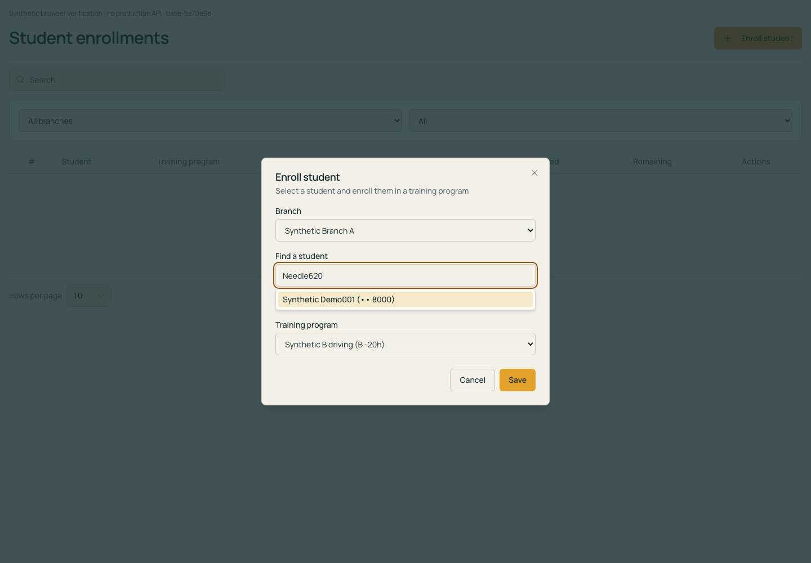
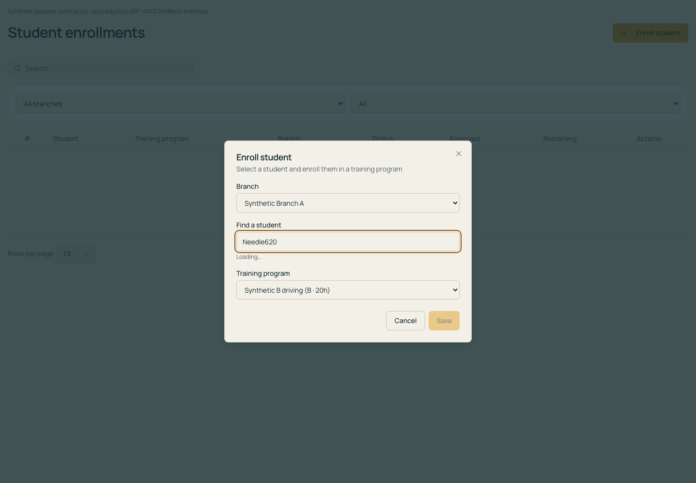
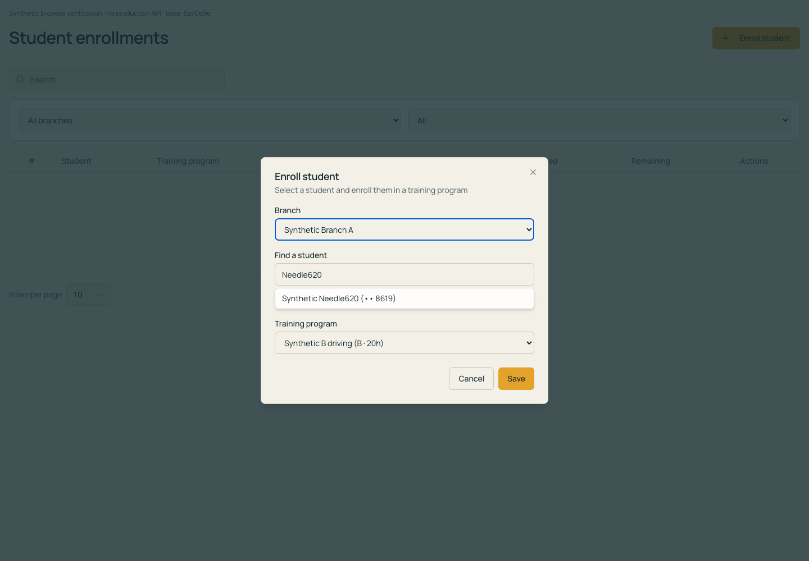
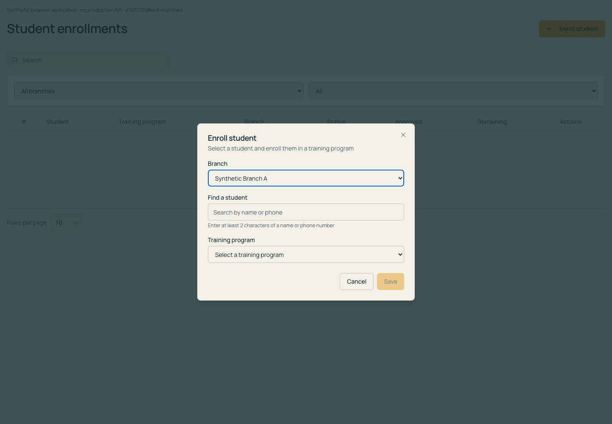
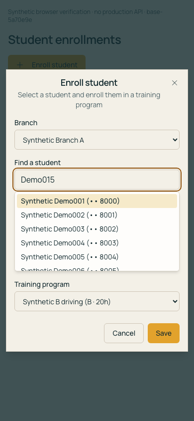
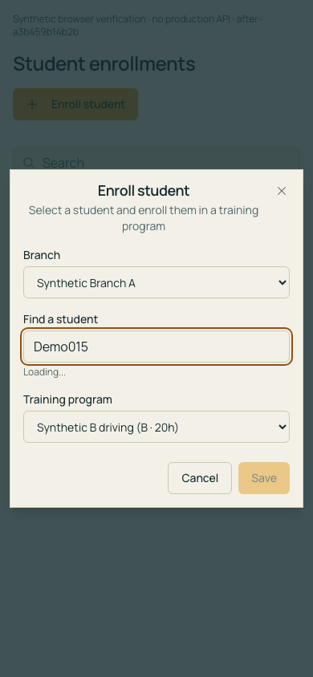
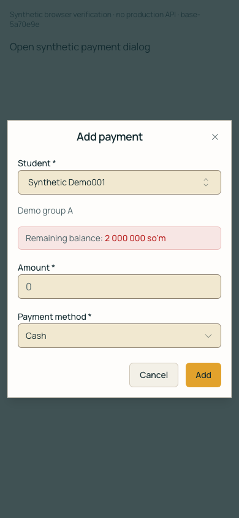
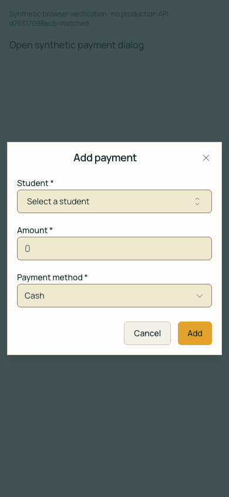

# Student picker safety evidence

References: #340 enrollment identity, #317 enrollment lookup feedback and keyboard interaction, #360 payment context safety. These follow merged #357's server search; the backend contract is unchanged.

Enrollment search edits and dismissal clear the selected identity. Loading, error and revoked-access states cannot submit old rows. The dialog shows masked phone/group details, filtered totals, retry/empty feedback, a selected-record label and keyboard navigation. Cancel/Escape restore opener focus; an overlay popup keeps pointer dismissal stable.

Payment sessions retire identity, cached debt and pending confirmations on effective branch/course/account/access changes. An explicit branch overrides unrelated global branch changes, and same-context search refinement preserves a deliberate selection even outside the bounded result page. Existing pinned/edit and retry behavior remains.

Changed implementation and regression files:

- `src/features/payments/api/PaymentModal.tsx`
- `src/features/payments/components/paymentModalScopeSafety.test.tsx`
- `src/features/payments/components/paymentModalConfirmations.test.tsx`
- `src/features/payments/components/paymentModalLockedStudent.test.tsx`
- `src/features/training/pages/TrainingEnrollmentsPage.tsx`
- `src/features/training/pages/trainingEnrollmentPicker.test.tsx`
- `src/hooks/useWriteOptions.ts`
- `src/hooks/useWriteOptions.test.tsx`
- `src/i18n/locales/en.json`, `src/i18n/locales/ru.json`, `src/i18n/locales/uz.json`
- `src/i18n/lookupLabels.test.ts`

Validation: Node 24.20.0, pinned pnpm 11.17.0; 218 Vitest files / 1,277 tests pass, TypeScript passes, ESLint passes with zero warnings, synthetic static build and bundle budget pass (initial JS 186.10 / 200 KiB). Cached React Doctor reports five component-size/complexity warnings and no errors; score/telemetry were disabled. No dependency, API, workflow or infrastructure changes.

These are actual Chromium 153.0.8010.12 captures of application components in an isolated local harness, using 620 fictional students and intercepted in-memory API responses/mutations. They are not production screenshots or live database/RLS acceptance. Locale en-US, browser timezone UTC; desktop 1440×1000 and mobile viewport 390×844. Mobile images were captured after resize settled and visually checked for clipping. Before uses immutable frontend `5a70e9e208fccc549565b29dcd991136f381b511`; after source content SHA256 is `d76317098ec64ad5695df434b666416cfccb72c44f51289c4f975ed68b6fb85a` (the twelve files above, before evidence packaging).

The matching edit/reopen/payment recipes start with Demo001 (`student-1`). The delayed-query recipe uses `Demo015` while the request is held. All names, phones, groups, balances and branches are synthetic. Captures were made on 2026-10-04 UTC: baseline at approximately 01:00 and matched after at 01:15–01:16; the delayed after capture is from the final browser run.

| Journey and viewport                                                                                                                               | Before                                                                                | After                                                                              |
| -------------------------------------------------------------------------------------------------------------------------------------------------- | ------------------------------------------------------------------------------------- | ---------------------------------------------------------------------------------- |
| Select Demo001 → edit search to Needle620, desktop. Old ID left Save enabled; now selection clears and Save is disabled during lookup.             |      |           |
| Cancel → reopen, desktop. Old query/program/ID survived; now a fresh draft opens.                                                                  |           |             |
| Held next query, mobile. Fifty prior-query rows remained selectable; now loading has no selectable stale rows and the program label stays visible. |               |                |
| Selected Demo001 → branch A/avto_maktab to branch B/tezkor, mobile. Old identity/debt survived; now both retire.                                   |  |  |

Browser journeys additionally cover name/phone matches beyond positions 50 and 500, delayed/out-of-order responses, errors/retry/empty states, stable-ID disambiguation, raw clearing, scope/grant changes, repeated actions, pending dismissal, pinned/edit controls, Tab/Space/Enter/Escape, mobile selection and successful save/reopen. No production payments, enrollments, reset/seed scripts or migrations were run.
